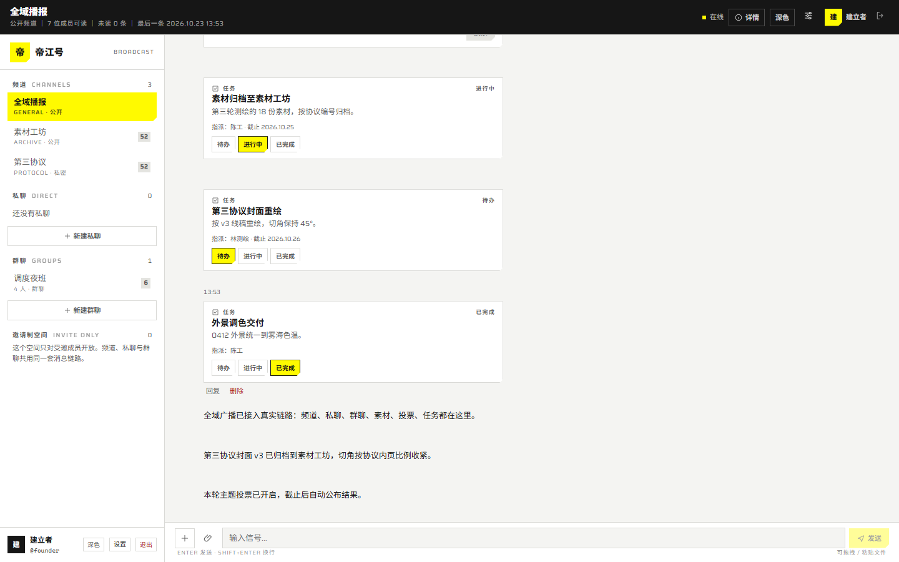
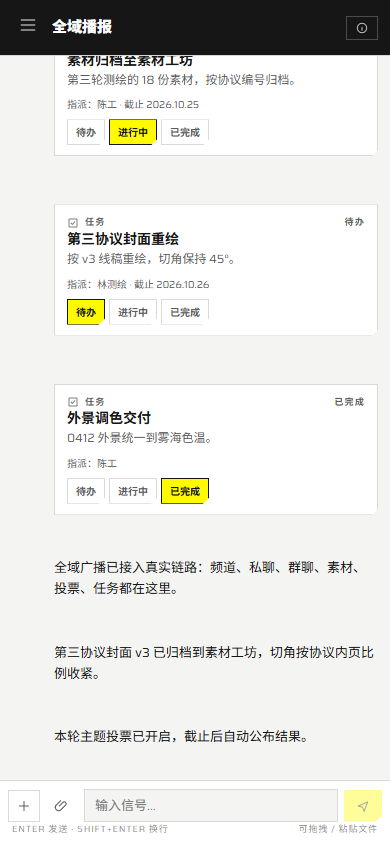
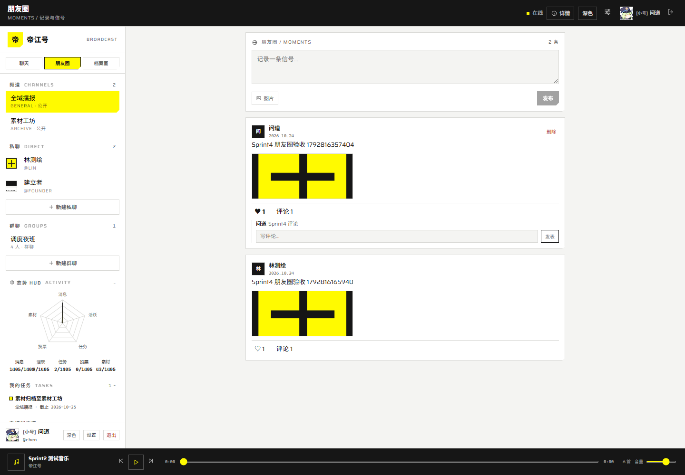
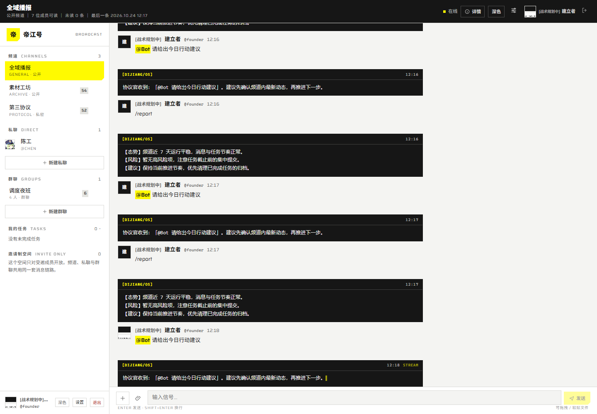

# O.M.V 工作台 · 全域广播
注:本人没法备案懒得修bug了，自修自用
> O.M.V. WORKBENCH / ALL-DOMAIN BROADCAST
> 一个邀请制创造性社团的私有协作空间：聊天是主干，素材 / 灵感 / 投票 / 任务 / 作品以**卡片**长在消息流里。
> 叙事：O.M.V《第三协议·协作条款》式的协议口吻；界面文案只用业务词。

> **许可证**：[GNU AGPL-3.0](LICENSE)

> [!WARNING]
> **免责声明 / Disclaimer**
>
> 1. **本项目是非官方的个人作品**，与任何游戏、动漫、影视公司及其关联实体**没有任何关系**，未获其授权、认可或赞助。
> 2. 仓库内的界面文案、术语已做**中性化处理**（如「工作台」「环塔」「日志板」等），不指向任何具体作品的世界观、角色或商标；如仍有残留，属于无意疏漏，权利人可提出，我们会立即更正或移除。
> 3. 软件按 **「现状」提供**，不附带任何明示或暗示的担保，包括但不限于可商用性、特定用途适用性与不侵权担保；使用、部署、二次分发的全部风险由使用者自行承担。
> 4. 使用者应自行确保其**所在法域、部署环境与数据内容**的合规性（含但不止于内容审核、数据留存、个人信息保护）；本项目不提供任何合规背书。
> 5. 项目中出现的第三方名称、商标、标识（如有）均归各自所有者所有，仅作指代用途，不构成任何权利主张。
> 6. 本软件以 **GNU AGPL-3.0** 发布（见 [LICENSE](LICENSE)）；若通过网络对外提供服务，须按第 13 条向使用者提供完整对应源代码。

---

## 1. 这是什么

- **形态**：单租户、邀请制、可私有化自托管的 Web 社区；**真实 Next.js 前端**（`web/`），桌面 + 390 移动端。
- **会话**：社区频道 + 私聊（DM）+ 群聊，三种会话共用消息/已读/线程/附件链路。
- **V1 已交付**：登录、频道、DM、群聊、附件上传/预览、素材/投票/任务卡片、编辑/删除、IM 布局、局域网访问。
- **V2 已交付 6 个 Sprint**：①触屏长按 ActionSheet / Virtuoso / 资料与状态前缀 / 群公告·解散·置顶；②音乐/图表/贴纸 / 代码高亮 / 我的任务 / Cmd+K；③AI 配置加密 / @Bot SSE / `/report`；④朋友圈 / 常驻播放器 / 档案室 Scramble / HUD 雷达与彩蛋；⑤邀请成员 UI / 严格斜杠指令拦截（`/task` `/poll` `/tasks` `/goto`）；⑥多 Bot 管理 / [BOT] 加人 / @Bot 自定义身份 / `/bot` `/clear` `/summarize` `/translate` `/roll`。
- **规模**：日常 8–20 人，架构按 50 人设计。
- **不做**：公开注册、多租户 SaaS、完整项目管理、音视频（仅预留 `/rtc` 信令位）。
- **技术**：Next.js 15 + React 19 + Tailwind v4 + Zustand + Recharts；NestJS 11 + Prisma 6 + PostgreSQL + Redis 7 + Socket.IO + S3。
- **交付**：17 节设计规格 + 前端/IM/局域网文档、可编译后端、真实前端、两套 8 屏 UI 设计稿、验收清单与实测报告。

---

## 2. 30 秒看懂

| 问题 | 答案 | 一句话理由 |
| --- | --- | --- |
| 消息怎么保证不丢不重？ | 先落库再 ack；`clientMsgId` 唯一键；断线按 cursor 补拉 | 50 人规模用 at-least-once + 去重最划算 |
| 多实例怎么广播？ | Socket.IO Redis adapter，房间 `channel:<id>` | 无需 sticky，扩副本不改代码 |
| 已读怎么不刷屏？ | 客户端 500ms 节流 + 服务端 300ms 合并取 max | 50 人不需要逐消息回执 |
| 文件怎么传？ | 预签名 PUT 直传 + complete 阶段 HEAD/魔数校验 | 不占 API 带宽，又保留服务端把关 |
| 权限怎么简单？ | 全局 3 角色 + 频道 2 角色 + 公开/私密可见性 | 不做通用 RBAC |
| 中文怎么搜？ | `tsvector('simple')` + `pg_trgm` 双索引，权限过滤 | 自托管不依赖分词扩展 |
| 通知怎么不烦人？ | 普通消息不产生通知行；提及/指派即时；其余聚合；DND 只放行 @ | 通知是例外，不是默认 |
| 卡片怎么统一？ | 一张 `cards` 表 + `kind` + `data jsonb`，不同视图渲染 | 素材/灵感/投票/任务/作品共用一套 |
| 私聊/群聊怎么做？ | `channels.kind = dm\|group` + `dm_key` 部分唯一索引，消息链路完全复用 | 不新增一套消息表，已读/线程/附件零重复 |
| 前端是真是假？ | `web/` 是 Next.js 真实应用，连 REST + WS + SSE；没有 API 时显示错误态 | 不用假数据糊弄验收 |
| AI Key 放哪？ | 后端 AES-256-GCM 密文存库，前端只拿掩码与流式文本 | Key 永不出后端 |
| 关系数据怎么写？ | 发帖/群解散/消息落库用 Prisma 事务 | 防孤儿数据 |

---

## 3. 交付地图（按需求 17 节）

| 节 | 内容 | 文件 |
| --- | --- | --- |
| 1 | 目标、范围、假设、缺口 | [docs/01-目标与缺口.md](docs/01-目标与缺口.md) |
| 2 | 数据模型（18 表） | [docs/02-数据模型.md](docs/02-数据模型.md) |
| 3 | 实时消息设计 | [docs/03-实时消息.md](docs/03-实时消息.md) |
| 4 | 文件上传 | [docs/04-文件上传.md](docs/04-文件上传.md) |
| 5 | 权限模型 | [docs/05-权限模型.md](docs/05-权限模型.md) |
| 6 | 搜索方案 | [docs/06-搜索方案.md](docs/06-搜索方案.md) |
| 7 | 通知与免打扰 | [docs/07-通知与免打扰.md](docs/07-通知与免打扰.md) |
| 8 | API 清单（REST 92 + WS 事件） | [docs/08-API清单.md](docs/08-API清单.md) |
| 9 | 非功能与可观测性 | [docs/09-非功能与可观测性.md](docs/09-非功能与可观测性.md) |
| 10 | 部署拓扑 | [docs/10-部署拓扑.md](docs/10-部署拓扑.md) |
| 11 | 项目结构 | [docs/11-项目结构.md](docs/11-项目结构.md) |
| 12 | 数据库迁移（0001–0006） | [docs/12-数据库迁移.md](docs/12-数据库迁移.md) |
| 13 | WS 事件协议 | [docs/13-WS事件协议.md](docs/13-WS事件协议.md) |
| 14 | 关键代码 6 段 | [docs/14-关键代码.md](docs/14-关键代码.md) |
| 15 | 环境变量 | [docs/15-环境变量.md](docs/15-环境变量.md) |
| 16 | 本地启动 | [docs/16-本地启动.md](docs/16-本地启动.md) |
| 17 | 验收清单 | [docs/17-验收清单.md](docs/17-验收清单.md) |
| 18 | 真实前端（Next.js） | [docs/18-前端.md](docs/18-前端.md) |
| 19 | 局域网访问 | [docs/19-局域网访问.md](docs/19-局域网访问.md) |
| 20 | IM 布局重构规格 | [docs/20-IM布局重构.md](docs/20-IM布局重构.md) |
| — | 冻结契约 + v1.1/v1.2 补遗 | [docs/_contract.md](docs/_contract.md)、[docs/_contract-v1.1.md](docs/_contract-v1.1.md)、[docs/_contract-v1.2.md](docs/_contract-v1.2.md) |
| — | 实测报告 | [reports/验证报告.md](reports/验证报告.md) |
| — | 真实基础设施报告 | [reports/infra/REPORT.md](reports/infra/REPORT.md) |
| — | 会话 / IM / Sprint 报告 | [reports/e2e/REPORT.md](reports/e2e/REPORT.md)、[reports/frontend/im-report.md](reports/frontend/im-report.md)、[Sprint1](reports/frontend/sprint1.md)、[Sprint2](reports/frontend/sprint2.md)、[Sprint3](reports/frontend/sprint3.md)、[Sprint4](reports/frontend/sprint4.md)、[Sprint5](reports/frontend/sprint5-commands.md)、[Multi-Bot](reports/frontend/multi-bot.md) |

---

## 4. 启动与验收

### 4.1 一键验收

| 系统 | 操作 |
| --- | --- |
| Windows | 双击根目录 [一键验收.cmd](一键验收.cmd) |
| Windows 终端 | `pwsh -ExecutionPolicy Bypass -File ops/acceptance/start.ps1` |
| Linux / macOS | `bash ops/acceptance/start.sh` |

自动模式会做**构建 + 单测 + 18 个设计稿页面检查**；不依赖 Docker。
真实前后端联调见 §4.3，真实基础设施见 [ops/infra/README.md](ops/infra/README.md)。

### 4.2 手动起真实全栈（本机推荐，无需 Docker）

```powershell
# 0) 真实 Redis + S3（Memurai + rclone，一次性/每次开机）
powershell -ExecutionPolicy Bypass -File ops/infra/start-real.ps1

# 1) PostgreSQL 17.5 + API（embedded PG，真实 PG 进程）
node ops/e2e/run-backend.mjs --skip-build --skip-seed

# 2) 前端
cd web; pnpm build; pnpm start -p 3100
```

API: `http://localhost:3000/readyz`（postgres/s3/redis 全 true）；Web: `http://localhost:3100`。
> 本机**没有 Docker/WSL/Hyper-V**，Docker Hub 也不可达；真实基础设施改用 Memurai（Redis 7 协议）+ rclone S3 + embedded PostgreSQL 17.5，见 [ops/infra/README.md](ops/infra/README.md)。`ops/docker-compose.yml` 仅作部署参考，本机未执行。

### 4.3 真实前端（Next.js）

```powershell
# 1) 真实 Redis + S3 + PG + API
powershell -ExecutionPolicy Bypass -File ops/infra/start-real.ps1
node ops/e2e/run-backend.mjs --skip-build --skip-seed   # PG:55432 + API:3000

# 2) 前端（另开终端）
cd web; pnpm build; pnpm start -p 3100                  # http://localhost:3100
```

登录：`founder / Dijiang#2026`（owner）或 `chen / Dijiang#2026`（成员）。
前端只做甲套视觉；两套静态设计稿仍在 `design/` 供对照。

> 附件上传走真实 S3。生产换成 MinIO/云 S3 并为桶配置 CORS（见 [docs/04](docs/04-文件上传.md) §3.1）；不再使用 s3rver/内存降级。

### 4.4 局域网访问（手机 / 其他电脑）

同一 WiFi 下用本机 LAN IP 访问，**不需要 Docker，也不需要 HTTPS**：

```powershell
pwsh -File ops/lan.ps1                 # 探测 LAN IP → 打印 env 与启动命令（可 -Ip 指定）
# 后端（LAN 监听，真实 Redis/S3）
$env:API_HOST='0.0.0.0'; node ops/e2e/run-backend.mjs --skip-build --skip-seed
# 前端（0.0.0.0:3100）
cd web && pnpm dev
```

手机打开 `http://<LAN_IP>:3100`（本次实测 `192.168.1.9`）；REST `:3000`、WS `ws://<LAN_IP>:3000/socket.io/`（命名空间 `/ws`）、附件直传 `:9000`（rclone S3，需绑定 0.0.0.0）。
登录会话是 **Bearer token + localStorage（无 Cookie）**，跨设备不涉及 SameSite/domain；HTTP 非 localhost 下 localStorage 可用，但 Web Push/Web Crypto/getUserMedia 等 Secure 上下文能力不可用（本系统未使用）。
完整机制、验收命令、防火墙与排障清单见 **[docs/19-局域网访问.md](docs/19-局域网访问.md)**。

### 4.5 公网部署与多实例（Caddy/nginx + Cloudflare Tunnel）

需要公网 HTTPS、同源反代、多 API 实例或没有公网 IP 时，见 **[docs/21-公网部署与多实例指南.md](docs/21-公网部署与多实例指南.md)**：
- 同源 TLS 样例：[ops/Caddyfile](ops/Caddyfile)（推荐，自动 HTTPS + WS + SSE 不缓冲）、[ops/nginx.conf](ops/nginx.conf)
- 拓扑与环境变量（`TRUST_PROXY=true`、`CORS_ORIGINS`、`REDIS_URL`、`S3_PUBLIC_ENDPOINT`、`DATABASE_POOL_MAX`）
- 多实例：Socket.IO Redis adapter / sticky / 滚动升级 / 连接池
- Cloudflare Tunnel：不暴露端口、HTTPS 由 CF 终止、S3 公网子域与限制
> 本机无 Docker/公网/域名/CF 账号，以上配置与流程**未实测**，文档已逐项标注未验证项。

---

## 5. 目录结构

```
O.M.V工作台全域广播/
├─ docs/                  17 节规格 + 契约 v1.1/v1.2 + 前端/IM/局域网文档
├─ server/                NestJS 11 + Prisma 6（源文件 140+；基线 99 例 + Sprint 定向 38 例）
│  ├─ prisma/             schema.prisma + 0001_init … 0006_sprint4
│  ├─ src/                社区 / conversations / cards / search / ai / posts / archive / stats
│  └─ test/               测试文件（sprint1–4 定向用例独立）
├─ web/                   Next.js 15 + Tailwind v4 真实前端（聊天/朋友圈/档案室/AI/播放器）
├─ ops/                   compose / Caddy / Makefile / start.ps1 / loadtest / infra
│  ├─ infra/              真实 Redis(Memurai) + S3(rclone) 启停脚本与说明
│  ├─ acceptance/         一键验收（构建+UI 检查）
│  └─ e2e/                embedded PG + API/WS/UI 冒烟（真实链路）
├─ 一键验收.cmd / .sh     一键验收入口（双击 / bash）
├─ design/
│  ├─ ui-endfield/        甲套：endfield-ui skill 规范，8 屏 + index
│  ├─ ui-independent/     乙套：独立设计「航测档案」，8 屏 + index
│  └─ README.md           两套对照与验收方法
└─ reports/               验证报告 + E2E/压测/前端 Sprint 证据 + 截图
```

---

## 6. 前端与两套 UI
### 6.1 真实前端（`web/`，甲套视觉）

Next.js 15 App Router + React 19 + TypeScript + **Tailwind v4**，连真实 REST/WS/SSE：
- 登录/邀请码注册、双 token + 401 自动 refresh；
- 社区频道、私聊、群聊（新建/改名/加人/移除/退出/解散归档）；
- 消息流：乐观发送、ack、5s 超时同 `clientMsgId` 重发、按 id 去重、断线指数退避、`ready` 后按 lastSeq 补拉、已读 500ms 节流；
- **IM 布局**：固定 Header/Composer、消息列表唯一滚动（React Virtuoso）、详情抽屉、顶部自动加载更早 + 「↓ 回到最新」、<768px 侧栏抽屉；
- **消息能力**：Markdown 白名单（代码高亮 + 复制）、音乐/图表/投票/任务/素材/贴纸卡片、附件上传（按钮/拖拽/粘贴/进度）、编辑/删除、触屏长按 ActionSheet；
- **资料与状态**：显示名、头像（S3 签名 URL）、状态前缀 `[战术规划中]`；
- **群管理**：公告 Markdown、拉人/踢人二次确认、群主危险区解散（输入群名确认）；
- **效率**：侧栏「我的任务」（Zustand 实时联动）、Cmd+K 全局搜索/`/goto`/`/tasks`、个人置顶；
- **V2 Sprint 4**：朋友圈（发布/点赞/评论/删除）、常驻音乐播放器、档案室 Scramble、HUD 雷达图、`/ping` 与 `sudo rm -rf /` 彩蛋；
- **V2 Sprint 5**：设置页邀请成员（仅 owner/admin；一次性明文码、列表/撤销；普通成员不可见）、严格斜杠指令（`/task` `/poll` `/tasks` `/goto`，保留 `/report` `/ping` sudo；集中 `lib/commands.ts`，不误伤 `/botany` `/tasks2`）；
- **V2 Sprint 6**：owner Bot 管理（头像/模型/Prompt/Key/测试/删除）、详情抽屉 Bot + [BOT] 加人、@Bot 使用自己的名称/头像流式、`/bot` `/clear` `/summarize` `/translate` `/roll`；
- **AI**：设置页管理员配置（Key 仅后端密文）、`@Bot` 流式回复、`/report` 行动效能评估（终端风消息）；
- 无 API 时显示“链路未连接”，**不展示演示数据**。









### 6.2 两套静态设计稿

| 套 | 概念 | 入口 | 与另一套的关键差异 |
| --- | --- | --- | --- |
| 甲 · 工业协议 | off-white + 荧光黄 `#FFFA00` + 切角 + 宽体英文 + 机械动效 | [design/ui-endfield/index.html](design/ui-endfield/index.html) | 严格依 endfield-ui skill；0 圆角/投影；深色完整（真实前端采用这套） |
| 乙 · 航测档案 | 暖纸 + 墨青 + 铜橙 + 衬线中文 + 票根/印章/台账 + 三栏抽屉 | [design/ui-independent/index.html](design/ui-independent/index.html) | 独立设计；2–4px 圆角；深色「夜航」 |

两套使用同一演示数据（3 频道 / 8 成员 / 5 素材 / 2 投票 / 3 任务 / 作品组图 / 2026.10.22），可直接并排比较。详见 [design/README.md](design/README.md)。

---

## 7. 验证状态（实测）

| 项 | 结果 | 证据 |
| --- | --- | --- |
| 后端 `pnpm build` / `pnpm test` | exit 0；**全量 99/99（11 文件）**；Sprint 1–5 另有定向用例 13/12/12/14 + 指令断言 8/9 | `reports/infra/REPORT.md`、`server/test/sprint*.spec.ts`、`reports/frontend/sprint5-commands-check.mjs` |
| 前端 `pnpm build`（Next 15） | exit 0，7/7 静态页 + `/api/ai/[kind]` 动态路由 | `reports/frontend/build.log` |
| 真实 PostgreSQL | embedded PG **17.5**；迁移 0001→0006 已应用；seed 8 用户/3 频道/2 DM/2 群聊 | `reports/e2e/run.json` |
| API/WS 冒烟 | **12/12 通过**：登录、频道收发（10–15ms）、DM 新建推送、群聊、断线补拉（0 重复/0 空洞）、上传 F9 | `reports/e2e/api-smoke.json` |
| UI 冒烟（Chrome/Playwright） | **4/4 通过**：登录→频道发消息→建私聊发消息→建群发消息；直连 PG 复核消息落库 | `reports/e2e/ui-smoke.json`、`ui-db-check.json` |
| 附件上传全链路 | **8/8 通过**：presign→PUT→complete→下载逐字节相等→附件消息；25MB/伪造 MIME 被拒 | `reports/e2e/upload-check.json` |
| API 冒烟（含上传） | **12/12 通过**（F9 上传并入） | `reports/e2e/api-smoke.json` |
| 前端日常档 | 上传/素材/投票/任务/编辑/删除在正常 Chrome + 真实 S3 验证，0 console error | `reports/frontend/capture-daily*.json` |
| IM 布局回归 | **16/16 通过**：无右栏/无楼层号、详情抽屉不挤压、hover 操作、上滚锚定 0 漂移、回底 39ms、输入框 1–5 行、＋菜单卡片、390 移动端；Console 0 error / 429 0 | `reports/e2e/im-ui-smoke.json` |
| 契约一致性 | 表 18/18、枚举 15/15、REST 92、WS 28 事件 | `docs/08`、`docs/13` |
| 静态 UI 设计稿 | 18 页 × 2 视口截图，0 控制台错误、0 横向溢出 | `reports/验证报告.md` §7 |
| 原 17 节验收 | 68 条：36 ✅ / 1 ❌ / 31 ⚠️；可判定 36/37 = 97.3% | [docs/17-验收清单.md](docs/17-验收清单.md) |
| Redis / S3 / PG | **真实服务**：Memurai 4.1.8（Redis 7 协议）、rclone S3 9000、PostgreSQL 17.5；`/readyz` 全 true、无 degraded；断开 Redis 时 API 启动 exit 1 | `reports/infra/`、`reports/e2e/upload-check.json` |
| 上传（真实 S3） | **8/8 通过**：预签名 PUT → complete → 下载逐字节一致；无 s3rver/CORS 代理 | `reports/e2e/upload-check.json` |
| PG 连接池 | **200 并发查询 / 0 失败 / 实际 20 backends / 302ms** | `reports/infra/pg-pool-check.json` |
| k6 压测 | **50 VU / 2 min：766 ack，P95 19.75ms，P99 51.1ms，失败 0，ack_ok 100%** | `reports/loadtest/k6-summary.json` |
| 断网 60s 补拉 | 离线 60001ms；重连补到 1394–1398，**duplicates 0 / holes 0** | `reports/infra/offline-gap.json` |
| Redis 不可用 | API 启动 **exit 1**（不降级） | `reports/infra/redis-down.json` |
| Sprint 1 前端 | 长按 Sheet / Virtuoso（初始 DOM 15、350 条后 24）/ 资料 / 群公告·解散 / 置顶 | [sprint1.md](reports/frontend/sprint1.md)、`sprint1-report.json` |
| Sprint 2 前端 | 代码高亮 / 音乐 / 图表 / 贴纸 96×96 / 我的任务 / Cmd+K | [sprint2.md](reports/frontend/sprint2.md)、`sprint2-report.json` |
| Sprint 3 前端 | AI 面板（无明文 Key）/ @Bot 流式 31→43 字 / `/report` | [sprint3.md](reports/frontend/sprint3.md)、`sprint3-report.json` |
| Sprint 4 前端 | 朋友圈 2 帖 ♥1 评论 1 / 播放器 / 档案室 19 条 / 雷达图 / ping / sudo | [sprint4.md](reports/frontend/sprint4.md)、`sprint4-report.json` |
| Sprint 5 前端 | 邀请成员 UI（一次性明文码/列表/撤销，仅 owner/admin）+ 8 条指令拦截（8 正向/9 负向） | [sprint5-commands.md](reports/frontend/sprint5-commands.md)、`sprint5-report.json` |
| Sprint 后端定向测试 | Sprint1 13 / Sprint2 12 / Sprint3 12 / Sprint4 14（只跑目标文件） | `server/test/sprint{1..4}.spec.ts` |

完整判定：[docs/17-验收清单.md](docs/17-验收清单.md)（✅ 通过 / ❌ 未达标 / ⚠️ 未验证 三态，不含糊）。
> 本机没有 Docker：Redis 用 Memurai（Redis 7 协议），S3 用 rclone 的 S3 服务（S3 兼容，非 MinIO）；两者都是真实服务进程，不是 s3rver/内存降级。Docker 不可用原因见 [ops/infra/README.md](ops/infra/README.md)。

---

## 8. 已知边界（诚实清单）

1. **推送**：决策层 + Web Push/FCM 适配已实现并有 12 例单测；真实投递未验证（无凭据）。
2. **预览 worker**：未实现，`preview_status=pending`，前端回退原图（Sprint 2 已用客户端缩略贴纸规避大图直出）。
3. **真实 LLM 供应商未接**：Sprint 3 仅用本地 mock（`ops/e2e/mock-ai.mjs`，127.0.0.1:4010）验证流式链路；真实 OpenAI/兼容网关的限流、配额、分块边界未验。
4. **后端 SSE CORS**：`reply.hijack` 后缺少 CORS 头，前端用同源代理 `web/app/api/ai/[kind]/route.ts` 兜底；建议下一轮后端补齐。
5. **音频播放未真机验证**：播放器只验证「点击前不加载 + 控件/队列」；网易云直链可能受版权限制；整页跳转（`/settings`）会停止播放，仅 SPA 切视图保持。
6. **列表虚拟化**：消息列表已接 Virtuoso（350 条实测 DOM 24）；**1000 条压测未单独造数验证**。
7. **触屏长按**：`navigator.vibrate` iOS Safari 不支持（自动静默）；真机未点验。
8. **音视频**：仅 `/rtc` 预留；开关开/关都返回 `NOT_IMPLEMENTED`。
9. **匿名投票**：接口匿名，数据库存 `user_id` 以保证一人一票/改选，DBA 可反查。
10. **中文搜索**：trigram 兜底，2 字查询在 30 万条时 P95 约 200ms（见 docs/06）。
11. **presence**：用户级两态；“电脑在线、手机离线”时通知被抑制（设备级 presence 未做）。
12. **可观测性栈**：仅有 `/metrics` 端点与指标定义，未随附 Prometheus/Grafana/Loki（P2）。
13. **测试策略**：按项目要求改为「只跑改动相关单测 + build」；Sprint 1–5 未做全量回归，全量 99 例基线为 infra 阶段结果。
14. **E2E 环境**：embedded PG 17.5；集群 SQL_ASCII、业务库 UTF8（Windows 中文路径绕行），生产用标准 UTF8。Redis 为 Memurai 4.1.8，S3 为 rclone 1.75.2（S3 兼容，非 MinIO）。详见 [ops/infra/README.md](ops/infra/README.md)。

---

## 9. 命名与文案约定

- 产品名：`O.M.V 工作台`；功能名：`全域广播`；英文：`O.M.V. WORKBENCH / ALL-DOMAIN BROADCAST`。
- 角色界面称呼：建立者（owner）、协议官（admin）、档案员（频道 moderator）、成员（member）。
- 业务词：信号（消息）、素材库、灵感墙、作品墙、发起投票、指派任务、归档素材。
- 不用风格词做按钮；每个标签用没读过设计文档的人也能懂的业务词。
