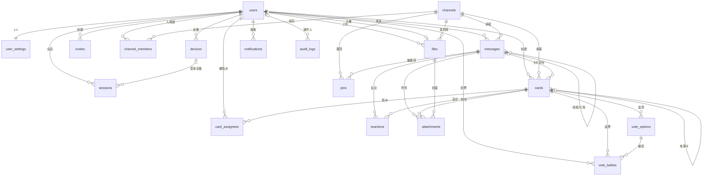

# 02 · 数据模型

> 协议编号：O.M.V-DJ / P-02　｜　版本：v1.0（+ 契约 v1.2 会话扩展增量）　｜　依据：`_contract.md` v1.0（冻结）§2、§3、`_contract-v1.2.md` §A
> 管辖：PostgreSQL 16 持久层。18 张表逐字段登记，不新增、不删除契约中的表 / 字段 / 索引；契约未显式规定处标 † 并给出落地口径，待 v1.1 回填。
> 扩展：`citext`、`pg_trgm`、`pgcrypto`；Windows 直装，无 Docker。
> 契约 v1.2 增量（§2.6）：`channels` 增加 `kind` / `dm_key` / `last_message_at` 三列，**表数量仍为 18**；DM/群聊复用 channels + channel_members + messages，不新建 conversations 表。

| 通用约定 | 取值 | 理由（一句） |
| --- | --- | --- |
| 主键 | `gen_random_uuid()`，除 messages / audit_logs | 除消息序外无全局排序需求，UUID 免去 ID 泄漏业务规模 |
| 单调序 | `BIGINT GENERATED ALWAYS AS IDENTITY` | 一个整数同时充当主键、分页游标、已读游标 |
| 时间 | 一律 `timestamptz` + 服务端 `now()` | 客户端时钟不可信，统一 UTC 存储 |
| 软删除 | 仅 messages / cards / files | 引用与审计价值高于存储成本 |
| 枚举 | PostgreSQL 原生 enum（契约 §1 的 12 个） | DB 层拒绝脏值，与代码枚举一一对应 |
| 命名 | 表小写复数，字段 snake_case，外键 `<表>_id` | 契约 / SQL / 代码三方同形，省一层映射 |
| 级联 | 从属 `CASCADE`；引用 `SET NULL` / `RESTRICT` | 循环外键（users↔files）必须 SET NULL |
| `updated_at` | 应用层写入，不建触发器 | 避免逻辑分散在两个执行平面 |

---

## 1. 关系总图



---

## 2. 表登记（数据字典）

编号沿用契约 §2.1–§2.18；「默认」列中 `—` 表示必填无默认。

### 2.1–2.5 身份与接入：users / user_settings / devices / sessions / invites

| 表 | 字段 | 类型 | 默认 | 外键 / 约束 | 说明 |
| --- | --- | --- | --- | --- | --- |
| users | id | uuid | `gen_random_uuid()` | PK | |
| users | handle | citext | — | UNIQUE NOT NULL；`^[a-z0-9_]+$`，3–24 | 登录名，大小写不敏感 |
| users | display_name | varchar(40) | — | NOT NULL | 显示名，可重复 |
| users | password_hash | text | — | NOT NULL | argon2id（m=19456,t=2,p=1） |
| users | avatar_file_id | uuid | NULL | → files.id `SET NULL` † | 循环外键，禁止 CASCADE |
| users | global_role | GlobalRole | `'member'` | NOT NULL | owner / admin / member |
| users | status | UserStatus | `'active'` | NOT NULL | 封禁只拦写与登录 |
| users | muted_until | timestamptz | NULL | | 全站禁言截止 |
| users | created_at / updated_at / last_seen_at | timestamptz | `now()` / `now()` / NULL | | last_seen_at 落库节流 60 s |
| user_settings | user_id | uuid | — | PK → users.id `CASCADE` | 主键即外键，1:1 |
| user_settings | locale / theme | varchar(8) / text | `'zh-CN'` / `'system'` | theme CHECK ∈ light/dark/system | 界面语言与主题 |
| user_settings | notify_level | NotifyLevel | `'all'` | NOT NULL | 全站默认通知级别 |
| user_settings | dnd_enabled | bool | `false` | NOT NULL | 免打扰总开关 |
| user_settings | dnd_start / dnd_end | time | NULL | 两者同处 `dnd_enabled=true` | 本地时间，允许跨零点 |
| user_settings | timezone | text | `'Asia/Shanghai'` | NOT NULL | IANA 名，静默判定依此 |
| user_settings | push_web / push_android | bool | `true` | NOT NULL | 分端推送开关 |
| user_settings | digest_window | int | `300` | CHECK 60–3600 | 聚合窗口秒 |
| user_settings | updated_at | timestamptz | `now()` | | |
| devices | id | uuid | `gen_random_uuid()` | PK | |
| devices | user_id | uuid | — | NOT NULL → users.id `CASCADE` | |
| devices | platform | Platform | — | NOT NULL | web / android |
| devices | name | varchar(60) | — | NOT NULL | 设备名 |
| devices | push_provider | text | — | CHECK ∈ webpush/fcm | 与 platform 联动校验 † |
| devices | push_token | text | — | NOT NULL；UNIQUE(platform, push_token) | endpoint / FCM token，重复注册走 UPSERT |
| devices | push_keys | jsonb | `'{}'` | | webpush 需 `{p256dh, auth}`，fcm 留空 |
| devices | last_active_at / created_at | timestamptz | `now()` | | 心跳或推送回执刷新 |
| sessions | id | uuid | `gen_random_uuid()` | PK | |
| sessions | user_id | uuid | — | NOT NULL → users.id `CASCADE` | |
| sessions | token_hash | text | — | UNIQUE NOT NULL | `sha256(refresh)`，明文不落库 |
| sessions | device_id | uuid | NULL | → devices.id `SET NULL` † | 删设备不销毁会话记录 |
| sessions | ip / user_agent | inet / text | NULL | | 登录来源，审计用 |
| sessions | expires_at | timestamptz | `now()+30 days` | NOT NULL | 契约 §7 refresh 30 天 |
| sessions | revoked_at | timestamptz | NULL | | 登出 / 轮换即撤销 |
| sessions | rotated_from | uuid | NULL | † 不建 FK | 轮换链排障；无约束以免删链连锁 |
| sessions | created_at | timestamptz | `now()` | | |
| invites | id | uuid | `gen_random_uuid()` | PK | |
| invites | code_hash | text | — | UNIQUE NOT NULL | `sha256(大写邀请码)` |
| invites | code_prefix | varchar(8) | — | NOT NULL | 前 4 位，管理台识别用，不可反推 |
| invites | created_by | uuid | — | NOT NULL → users.id `RESTRICT` † | 邀请人展示 |
| invites | role | GlobalRole | `'member'` | CHECK ∈ member/admin | 不允许邀请出 owner |
| invites | max_uses / uses | int | `1` / `0` | CHECK ≥1 / ≥0 | 原子自增，`WHERE uses<max_uses` |
| invites | expires_at | timestamptz | `now()+7 days` | NOT NULL | |
| invites | revoked_at | timestamptz | NULL | | 撤销即时生效 |
| invites | note | varchar(80) | `''` | | 用途备注 |
| invites | created_at | timestamptz | `now()` | | |

users：† owner 唯一性由应用层维护（契约 §4 规则 5 明确 MVP 不做 DB 约束）。
sessions：refresh 成功 → 旧行 `revoked_at=now()` + 新行 `rotated_from=旧 id`，同一事务。
invites：状态不落库，由 `revoked_at / expires_at / uses<max_uses` 三条件派生（见 `05-权限模型.md` §6）。

### 2.6–2.9 频道与消息：channels / channel_members / messages / reactions

| 表 | 字段 | 类型 | 默认 | 外键 / 约束 | 说明 |
| --- | --- | --- | --- | --- | --- |
| channels | id | uuid | `gen_random_uuid()` | PK | |
| channels | name | varchar(60) | — | NOT NULL | 界面名，可重复；DM 允许空串、群聊必填 1–60（契约 v1.2） |
| channels | slug | citext | — | UNIQUE NOT NULL；`^[a-z0-9-]+$` † | 路由与提及的稳定标识；DM 派生 `dm-<dm_key 前 32 位>`、群聊 `group-<uuid>` |
| channels | topic | varchar(200) | `''` | | |
| channels | visibility | Visibility | `'public'` | NOT NULL | public / private |
| channels | position | int | `0` | NOT NULL | 侧栏排序 |
| channels | created_by | uuid | — | NOT NULL → users.id `RESTRICT` | |
| channels | kind | ChannelKind | `'channel'` | NOT NULL（契约 v1.2 §A1） | channel / dm / group；社区频道恒为 channel |
| channels | dm_key | varchar(80) | NULL | 部分唯一索引 `WHERE dm_key IS NOT NULL`（契约 v1.2 §A2） | 仅 kind=dm：`sha256(排序后的两个 userId 以 ':' 连接)`，64 位十六进制 |
| channels | last_message_at | timestamptz | NULL | | 会话列表排序；发消息时与消息同事务更新（`messages.service#insertMessage`） |
| channels | archived_at | timestamptz | NULL | | `DELETE /channels/:id` 落此列 |
| channels | created_at / updated_at | timestamptz | `now()` | | |
| channel_members | channel_id | uuid | — | PK 之一 → channels.id `CASCADE` | |
| channel_members | user_id | uuid | — | PK 之一 → users.id `CASCADE` | 复合主键 |
| channel_members | role | ChannelRole | `'member'` | NOT NULL | member / moderator |
| channel_members | notify_level | NotifyLevel | `'all'` | NOT NULL | 频道级覆盖；加入时快照全站值 † |
| channel_members | muted_until | timestamptz | NULL | | 频道内禁言 |
| channel_members | last_read_seq | bigint | `0` | CHECK ≥0 | 已读游标 = 已确认最大 messages.id |
| channel_members | last_read_at / joined_at | timestamptz | `now()` | | |
| messages | id | bigint IDENTITY | 自增 | PK | 全域单调序，即游标 |
| messages | channel_id | uuid | — | NOT NULL → channels.id `CASCADE` † | |
| messages | sender_id | uuid | — | NOT NULL → users.id `RESTRICT` † | 留档，不随删号消失 |
| messages | kind | MessageKind | `'text'` | NOT NULL | text/image/file/card/system |
| messages | body | text | `''` | CHECK `char_length ≤ 8000` | 轻量 Markdown；非 text 也可带说明 |
| messages | client_msg_id | uuid | — | NOT NULL，参与唯一键 | 客户端幂等键 |
| messages | parent_id | bigint | NULL | → messages.id `CASCADE` † | 单层线程：指向根 |
| messages | thread_root_id | bigint | NULL | → messages.id `CASCADE` † | 根消息为 NULL |
| messages | reply_to_id | bigint | NULL | → messages.id `SET NULL` † | 引用任意信号，删源不清正文 |
| messages | card_id | uuid | NULL | → cards.id `SET NULL` | kind=card 时 |
| messages | mentions | uuid[] | `'{}'` | NOT NULL | 被 @ 用户 |
| messages | thread_reply_count | int | `0` | NOT NULL，仅根维护 | 冗余计数 |
| messages | last_reply_at | timestamptz | NULL | 仅根维护 | 线程活跃排序 |
| messages | edited_at / deleted_at | timestamptz | NULL | | 15 分钟内可编辑；软删正文置空 † |
| messages | deleted_by | uuid | NULL | | 作者删 / 管理员删，审计用 |
| messages | created_at | timestamptz | `now()` | | |
| messages | search_vector | tsvector | 生成列 | `to_tsvector('simple', coalesce(body,''))` STORED | 全文检索 |
| reactions | id | uuid | `gen_random_uuid()` | PK | |
| reactions | message_id | bigint | NULL | → messages.id `CASCADE` | 与 card_id 二选一 |
| reactions | card_id | uuid | NULL | → cards.id `CASCADE` | |
| reactions | user_id | uuid | — | NOT NULL → users.id `CASCADE` | |
| reactions | emoji | varchar(32) | — | NOT NULL | 单个 emoji，按码点校验 † |
| reactions | created_at | timestamptz | `now()` | | |

messages：单层线程——根 `thread_root_id IS NULL`；回复 `thread_root_id = parent_id = 根 id`（契约 §2.8）；`CHECK (parent_id IS NULL OR thread_root_id IS NOT NULL)`。
messages：`UNIQUE(channel_id, sender_id, client_msg_id)` 是幂等键，写冲突即返回已存消息。
channel_members：`SET last_read_seq = GREATEST(last_read_seq, $seq)`，乱序回执不倒退。
reactions：`CHECK (num_nonnulls(message_id, card_id) = 1)`。

channels（契约 v1.2 §A，迁移 `0002_conversations`）：
- `kind` 区分三种会话：`channel`（社区频道，存量行默认值）/ `dm`（私聊）/ `group`（群聊）；社区频道的创建、权限、列表逻辑完全不变。
- DM 的 `name` 允许空串（前端用对方显示名渲染），`visibility='private'`，`dm_key` 作为**同一对人永不多行**的幂等键；群聊 `name` 必填 1–60，创建者 `channel_members.role='moderator'`。
- 一方退出 DM 时清空 `dm_key`（会话行与历史保留，对留下的一方仍可见，契约 v1.2 §D4），释放幂等槽位后同一对人可「重新发起需要新建」。
- 约束：`CHECK (dm_key IS NULL OR kind = 'dm')`（防止把频道/群聊误标成私聊幂等行）、`CHECK (kind <> 'group' OR char_length(btrim(name)) BETWEEN 1 AND 60)`。

### 2.10–2.12 文件与置顶：files / attachments / pins

| 表 | 字段 | 类型 | 默认 | 外键 / 约束 | 说明 |
| --- | --- | --- | --- | --- | --- |
| files | id | uuid | `gen_random_uuid()` | PK | |
| files | owner_id | uuid | — | NOT NULL → users.id `RESTRICT` | 上传者 |
| files | channel_id | uuid | NULL | → channels.id `SET NULL` † | 素材库归属；归档不销毁对象 |
| files | bucket / storage_key | text | — | storage_key UNIQUE NOT NULL | 对象键由服务端生成，不可猜 |
| files | original_name | varchar(255) | — | NOT NULL | 展示名，落库前净化 |
| files | mime | varchar(120) | — | NOT NULL | 服务端嗅探结果，非客户端声明 |
| files | kind | FileKind | — | NOT NULL | image/video/audio/document/archive/other |
| files | size_bytes | bigint | — | CHECK ≥0 | HeadObject 实测值 |
| files | checksum_sha256 | char(64) | NULL | | 秒传与去重预留 |
| files | width / height / duration_ms | int | NULL | | 图片、视频、音视频元数据 |
| files | preview_key | text | NULL | | 缩略图对象键 |
| files | preview_status | PreviewStatus | `'none'` | NOT NULL | none/pending/ready/failed |
| files | status | FileStatus | `'pending'` | NOT NULL | pending/ready/rejected/deleted |
| files | created_at | timestamptz | `now()` | | |
| attachments | id | uuid | `gen_random_uuid()` | PK | |
| attachments | file_id | uuid | — | NOT NULL → files.id `CASCADE` | |
| attachments | message_id | bigint | NULL | → messages.id `CASCADE` | 与 card_id 二选一 |
| attachments | card_id | uuid | NULL | → cards.id `CASCADE` | |
| attachments | position | int | `0` | NOT NULL | 附件顺序 |
| attachments | created_at | timestamptz | `now()` | | |
| pins | channel_id | uuid | — | PK 之一 → channels.id `CASCADE` | |
| pins | message_id | bigint | — | PK 之一 → messages.id `CASCADE` | 同消息同频道只置顶一次 |
| pins | pinned_by | uuid | — | NOT NULL → users.id | |
| pins | created_at | timestamptz | `now()` | | |

attachments：`CHECK (num_nonnulls(message_id, card_id) = 1)`；单条消息 ≤10 个附件（应用层计数，契约 §9）。

### 2.13–2.16 卡片子系统：cards / card_assignees / vote_options / vote_ballots

| 表 | 字段 | 类型 | 默认 | 外键 / 约束 | 说明 |
| --- | --- | --- | --- | --- | --- |
| cards | id | uuid | `gen_random_uuid()` | PK | |
| cards | channel_id | uuid | — | NOT NULL → channels.id `CASCADE` | |
| cards | kind | CardKind | — | NOT NULL | material/idea/vote/task/artwork |
| cards | title | varchar(120) | — | NOT NULL | |
| cards | body | text | `''` | CHECK `char_length ≤ 4000` | |
| cards | color | varchar(16) | NULL | CHECK ∈ amber/teal/rose/violet/slate | 灵感墙色标 |
| cards | tags | text[] | `'{}'` | NOT NULL | 素材库标签 |
| cards | position | double precision | `1000` | NOT NULL | 拖拽排序 |
| cards | status | CardStatus | `'open'` | NOT NULL | open/done/closed/archived |
| cards | task_status | TaskStatus | NULL | 仅 kind=task | todo/doing/done |
| cards | due_at | timestamptz | NULL | | 任务截止，触发 card_due |
| cards | closed_at | timestamptz | NULL | | 投票截止 / 归档 |
| cards | message_id | bigint | NULL | → messages.id `SET NULL` | 卡片在频道流里的信号 |
| cards | source_card_id | uuid | NULL | → cards.id `SET NULL` | 由哪张卡转换而来 |
| cards | created_by | uuid | — | NOT NULL → users.id `RESTRICT` | |
| cards | data | jsonb | `'{}'` | NOT NULL | vote `{multi,anonymous,closesAt,quorum?}`；artwork `{coverFileId,caption}`；material `{fileCount}` |
| cards | created_at / updated_at / deleted_at | timestamptz | `now()` / `now()` / NULL | | 软删除 |
| card_assignees | card_id | uuid | — | PK 之一 → cards.id `CASCADE` | |
| card_assignees | user_id | uuid | — | PK 之一 → users.id `CASCADE` | |
| card_assignees | assigned_by / assigned_at | uuid / timestamptz | — / `now()` | assigned_by → users.id | 指派者与时间 |
| vote_options | id | uuid | `gen_random_uuid()` | PK | |
| vote_options | card_id | uuid | — | NOT NULL → cards.id `CASCADE` | |
| vote_options | label | varchar(80) | — | NOT NULL | 选项文案 |
| vote_options | position | int | `0` | UNIQUE(card_id, position) | 展示顺序 |
| vote_ballots | id | uuid | `gen_random_uuid()` | PK | |
| vote_ballots | card_id / option_id | uuid | — | NOT NULL → cards.id / vote_options.id `CASCADE` | 选票所指 |
| vote_ballots | user_id | uuid | — | NOT NULL → users.id `CASCADE`；UNIQUE(card_id, option_id, user_id) | 仅用于一人一票与改票 |
| vote_ballots | created_at | timestamptz | `now()` | | |

cards：`data` 无库级 schema，写入前用 zod 校验。
vote_ballots：匿名投票的 `user_id` 必须入库（唯一性所需），接口层一律不返回（契约 §2.16）——这是接口约定，不是密码学保证。

### 2.17–2.18 通知与审计：notifications / audit_logs

| 表 | 字段 | 类型 | 默认 | 外键 / 约束 | 说明 |
| --- | --- | --- | --- | --- | --- |
| notifications | id | uuid | `gen_random_uuid()` | PK | |
| notifications | user_id | uuid | — | NOT NULL → users.id `CASCADE` | 接收人 |
| notifications | type | NotificationType | — | NOT NULL | 7 类，见 `07` |
| notifications | channel_id | uuid | NULL | → channels.id `CASCADE` † | |
| notifications | message_id | bigint | NULL | → messages.id `CASCADE` † | |
| notifications | card_id | uuid | NULL | → cards.id `CASCADE` † | |
| notifications | title / body | varchar(120) / varchar(300) | — / `''` | title NOT NULL | 已渲染文案，不存模板 |
| notifications | payload | jsonb | `'{}'` | NOT NULL | 跳转参数与聚合键 |
| notifications | read_at | timestamptz | NULL | | 已读时间（用户行为） |
| notifications | pushed_at | timestamptz | NULL | | 推送出队时间 |
| notifications | push_status | PushStatus | `'pending'` | NOT NULL | pending/sent/failed/skipped（投递结果） |
| notifications | created_at | timestamptz | `now()` | | |
| audit_logs | id | bigint IDENTITY | 自增 | PK | 日志量级大，bigint 省空间 |
| audit_logs | actor_id | uuid | NULL | → users.id `SET NULL` † | 系统动作可为空 |
| audit_logs | action | varchar(64) | — | NOT NULL | 点分命名，如 `channel.member.remove` |
| audit_logs | target_kind / target_id | varchar(32) / text | — | NOT NULL | 目标主键类型不一，存文本 |
| audit_logs | meta | jsonb | `'{}'` | NOT NULL | 变更前后摘要 |
| audit_logs | ip | inet | NULL | | |
| audit_logs | created_at | timestamptz | `now()` | | 只追加，不更新删除 |

notifications：`read_at` 与 `push_status` 是两个独立维度——已读是用户行为，推送是投递结果。

---

## 3. 索引与关键约束（迁移可直接执行）

```sql
-- 主分页与线程分页
CREATE INDEX messages_channel_seq ON messages (channel_id, id DESC);
CREATE INDEX messages_thread_seq ON messages (thread_root_id, id) WHERE thread_root_id IS NOT NULL;
CREATE INDEX messages_sender_seq ON messages (sender_id, id DESC);
CREATE INDEX messages_card ON messages (card_id);
-- 检索骨架（原因见 06），trgm 兜底中文子串
CREATE INDEX messages_search_gin ON messages USING gin (search_vector);
CREATE INDEX messages_body_trgm ON messages USING gin (body gin_trgm_ops);
CREATE INDEX messages_mentions ON messages USING gin (mentions);
-- 幂等发送：冲突即返回已存消息（dup:true）；单层线程结构
ALTER TABLE messages ADD CONSTRAINT messages_client_dedup UNIQUE (channel_id, sender_id, client_msg_id);
ALTER TABLE messages ADD CONSTRAINT messages_thread_shape CHECK (parent_id IS NULL OR thread_root_id IS NOT NULL);
-- 双可空外键去重只能靠部分唯一索引
CREATE UNIQUE INDEX reactions_msg_uniq ON reactions (user_id, emoji, message_id) WHERE message_id IS NOT NULL;
CREATE UNIQUE INDEX reactions_card_uniq ON reactions (user_id, emoji, card_id) WHERE card_id IS NOT NULL;
CREATE UNIQUE INDEX attach_msg_uniq ON attachments (file_id, message_id) WHERE message_id IS NOT NULL;
CREATE UNIQUE INDEX attach_card_uniq ON attachments (file_id, card_id) WHERE card_id IS NOT NULL;
-- 其余业务索引
CREATE INDEX channel_members_user ON channel_members (user_id);
CREATE INDEX channel_order ON channels (archived_at, position);
-- 契约 v1.2 §A2：会话扩展（迁移 0002_conversations）
CREATE UNIQUE INDEX channels_dm_key_key ON channels (dm_key) WHERE dm_key IS NOT NULL;
CREATE INDEX channels_kind_position_idx ON channels (kind, position);
ALTER TABLE channels ADD CONSTRAINT channels_dm_key_kind_check CHECK (dm_key IS NULL OR kind = 'dm');
ALTER TABLE channels ADD CONSTRAINT channels_group_name_check CHECK (
  kind <> 'group' OR char_length(btrim(name)) BETWEEN 1 AND 60
);
CREATE INDEX cards_board ON cards (channel_id, kind, position);
CREATE INDEX cards_recent ON cards (channel_id, created_at DESC);
CREATE INDEX cards_tags ON cards USING gin (tags);
CREATE INDEX cards_due ON cards (channel_id, due_at) WHERE task_status <> 'done';
CREATE INDEX cards_message ON cards (message_id);
CREATE INDEX cards_source ON cards (source_card_id);
CREATE INDEX card_assignees_user ON card_assignees (user_id);
CREATE INDEX vote_options_card ON vote_options (card_id);
CREATE INDEX vote_ballots_card ON vote_ballots (card_id);
CREATE INDEX vote_ballots_user ON vote_ballots (user_id);
CREATE INDEX files_archive ON files (channel_id, kind, created_at DESC);
CREATE INDEX files_owner ON files (owner_id);
CREATE INDEX files_status ON files (status);
CREATE INDEX attachments_msg ON attachments (message_id);
CREATE INDEX attachments_card ON attachments (card_id);
CREATE INDEX notifications_list ON notifications (user_id, read_at, created_at DESC);
CREATE INDEX notifications_unread ON notifications (user_id, created_at DESC) WHERE read_at IS NULL;
CREATE INDEX notifications_gc ON notifications (created_at);
CREATE INDEX audit_created ON audit_logs (created_at DESC);
CREATE INDEX audit_actor ON audit_logs (actor_id, created_at DESC);
CREATE INDEX invites_creator ON invites (created_by);
CREATE INDEX invites_expiry ON invites (expires_at);
CREATE INDEX sessions_user_revoked ON sessions (user_id, revoked_at);
CREATE INDEX devices_user ON devices (user_id);
```

---

## 4. 关键取舍

| 议题 | 采用 | 理由（一句） | 备选与代价 |
| --- | --- | --- | --- |
| 消息主键 | 全局 `bigint IDENTITY` 单调序 | 一个整数同时承担主键、分页游标、已读游标，无需二次索引 | 雪花 ID：需 workerId 与时钟回拨处理，单库下只是负担；UUIDv7：近似有序但 16 字节，游标需额外编解码 |
| 卡片建模 | 单表 + `kind` + `data jsonb` | 五类卡片八成字段重合，共用列表 / 排序 / 权限代码 | 分表：跨类查询要 UNION，跨类拖拽排序无法实现；继承表：JOIN 变多、迁移复杂 |
| 会话建模（契约 v1.2） | `channels` 增 3 列承担 DM / 群聊 | 消息、已读、线程、附件、反应全部复用既有链路，零重复 | 独立 `conversations` 表：两套消息链路 + 双写 + 历史迁移，收益仅语义清晰 |
| 已读 | `last_read_seq` 单游标 | 50 人规模未读数一条 SQL 出结果，写入是单行覆盖 | 逐消息回执表：行数 = 成员 × 消息，一年后千万级，收益仅是消息级精确回执 |
| 反应双目标 | 双可空外键 + 部分唯一索引 | 消息与卡片共用表情聚合代码与事件 | 两张表：前端两套事件；单表多态：无法建外键 |
| 全文检索 | 生成列 `search_vector` | 写入即得，不存在应用与库双写不一致 | 触发器：库外改 body 也生效，但逻辑分两处、调试成本高 |
| 线程 | 单层（根 + 回复） | 界面是两层折叠面板，无更深 UI | 无限嵌套：`ltree` 或递归 CTE，读放大与越权校验复杂度上升 |
| 提及 | `uuid[]` + GIN | 写入单行，`@>` 走索引 | 关联表：便于统计与级联清理，但每条消息多 N 行写入 |
| 排序 | `double precision position` | 插入两点之间只需一次 UPDATE | `int` 步长：长期拖拽耗尽间隙，需要全量重排任务 |
| 删除语义 | 三表软删，其余状态位 / 物理删 | 消息与卡片的引用、审计价值高于存储成本 | 全表软删：每个查询都要带 `deleted_at IS NULL`，漏写即泄漏 |
| 审计主键 | `bigint IDENTITY` | 日志量远大于业务表，8 字节且天然有序 | uuid：索引体积翻倍且无排序价值 |
| 冗余计数 | 同步维护 `thread_reply_count` | 线程入口列表读多写少 | 异步聚合：热点行锁消失，但列表会短暂不准 |

---

## 5. 增长与已识别薄弱点

| 表 | 验收基线（契约 §12） | 一年预估（50 人） | 处置 |
| --- | --- | --- | --- |
| messages | ≥500 | ~30 万 | 现有索引足够；超千万再按月分区 |
| reactions / notifications | 20 / ≥30 | ~5 万 / ~20 万 | 通知 90 天清理（见 `07`） |
| audit_logs / files | — / ≥12 | 十万级 / ~1 万 | 审计 180 天归档；文件主体在对象存储 |

1. **匿名投票非密码学匿名**：`user_id` 是「一人一票 + 改票」的必要条件，匿名性只由接口层保证；直连库或读备份可反查。要真匿名需改为聚合计数 + 无归属票据，代价是失去改票与防刷。
2. **根消息行是热点**：`thread_reply_count` 与 `last_reply_at` 同事务更新同一行，单线程高频回复形成行锁竞争。
3. **`cards.data` 无库级约束**：jsonb 形态只由应用层 zod 校验，历史数据格式漂移无 DB 兜底。
