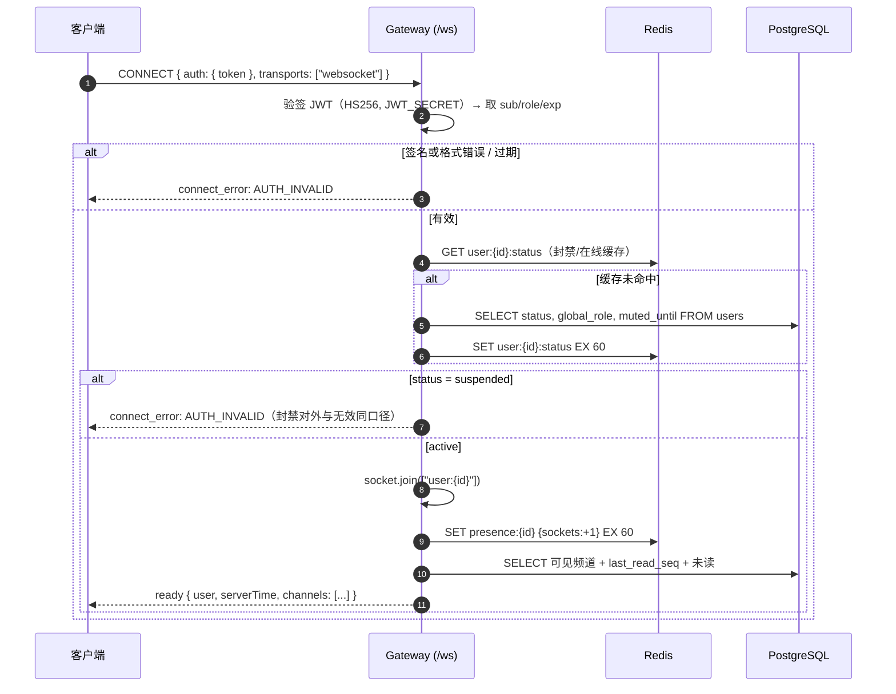
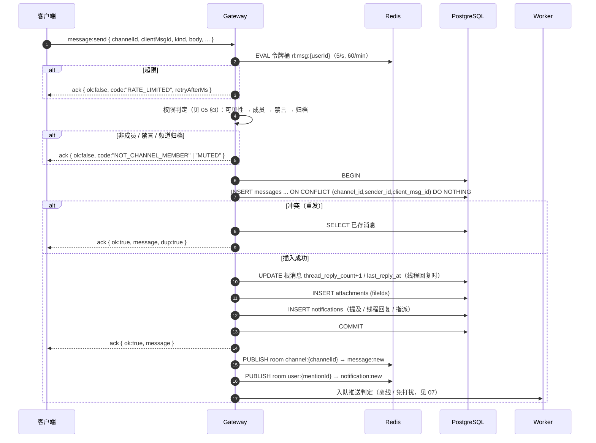

# 03 · 实时消息

> 协议编号：O.M.V-DJ / P-03　｜　版本：v1.0　｜　依据：`_contract.md` v1.0 §3、§6、§8、§9、§11；时序预算见 `09-非功能与可观测性.md`。
> 管辖：Socket.IO 命名空间 `/ws` 的连接、发送、广播、补拉、已读、在线状态、多实例与重连。REST 兜底与契约同语义，不另立规则。
> 一句话判据：**持久化成功才算发出**，其余一切（ack、广播、通知、计数）都在事务提交之后。

| 参数 | 值 | 依据 |
| --- | --- | --- |
| 命名空间 | `/ws` | 契约 §6 |
| 传输 | 仅 `websocket` | 契约 §6；无轮询降级，故多实例无需 sticky |
| 客户端 ack 超时 | 5 s | 契约 §6 |
| access / refresh | 15 min / 30 d | 契约 §7 |
| 心跳（Socket.IO ping） | 25 s | 与 `10-部署拓扑.md` 反代读超时 ≥300 s 对齐 |
| 单次补拉上限 | 100，默认 50 | 契约 §3 |
| 已读节流 | 客户端 500 ms，服务端合并 300 ms | 契约 §9 |
| 输入中过期 | 3000 ms | 契约 §9 |
| 发送频率 | 5 条/秒突发，60 条/分钟/用户 | 契约 §9 |

---

## 1. 连接与鉴权

握手在 middleware 内完成，连接建立前不做任何业务查询的兜底分支。



**连接期 token 过期处理**

| 场景 | 处理 |
| --- | --- |
| 首次握手 token 已过期 | `connect_error: AUTH_INVALID`（契约 §6 统一口径，不下发 `TOKEN_EXPIRED`） |
| 连接存活期内 access 过期 | 不断开。socket 已鉴权，鉴权结果缓存在 socket 上下文；REST 侧由客户端静默 refresh |
| 断线重连时 token 过期 | 客户端先 `POST /auth/refresh`（失败则登出），再以新 token 重连；最多重试 3 次 |
| 会话被撤销（登出全部设备） | 服务端在 `POST /auth/logout` 后向 `user:{id}` 房间发 `error { code: "AUTH_INVALID" }` 并断开该用户全部 socket |
| 用户被封禁 / 全站禁言变更 | 同上，30 s 内由管理动作主动触发；禁言只影响写，连接保留 |

理由（一句）：握手校验一次、连接内不再逐帧验签，是为了把每帧开销压到一次 Redis 读；过期边界交给重连流程处理。

---

## 2. 发送链路：持久化 → 广播 → ack



**规则**

| 规则 | 内容 | 理由 |
| --- | --- | --- |
| ack 时机 | 事务提交**之后**才 ack | 客户端收到 ack 即视为可信，崩溃后必须能补拉到 |
| 广播时机 | 与 ack 同批，在 `COMMIT` 返回后立即发 | 避免「广播先于可见」导致接收端回查拿不到 |
| 失败 ack | `{ ok:false, code, message }`；`MUTED` 附 `until`，`RATE_LIMITED` 附 `retryAfterMs` | 契约 §8 要求这两项载荷，WS ack 无 HTTP body，只能同级返回 |
| 未 ack 超时 | 客户端用同一 `clientMsgId` 重发；服务端返回已存消息 + `dup:true` | 契约 §6 ack 语义 |
| 广播内容 | 完整 `message` 对象，不依赖接收端二次请求 | 接收端离线补拉与实时同形，前端一条渲染路径 |

**端到端预算**（对齐 `09` 的 S1 = P95 < 300 ms）：鉴权 + 权限 15 ms、写事务 40 ms、广播 35 ms、网络与序列化余量 210 ms。

---

## 3. 幂等与去重

```sql
-- 唯一键即幂等键；冲突时不报错、不回滚，转为读取已存行
INSERT INTO messages (channel_id, sender_id, kind, body, client_msg_id, parent_id, thread_root_id)
VALUES ($1,$2,$3,$4,$5,$6,$7)
ON CONFLICT (channel_id, sender_id, client_msg_id) DO NOTHING
RETURNING *;
```

| 层 | 去重依据 | 说明 |
| --- | --- | --- |
| 客户端发送 | `clientMsgId`（uuid v4，消息创建时生成，重发复用） | 同一消息的所有重试共享同一 id |
| 服务端存储 | `UNIQUE(channel_id, sender_id, client_msg_id)` | 并发重发由唯一键收敛为一行 |
| 客户端渲染 | `messages.id` 为集合键 | 补拉与实时推送叠加时按 id 去重，不按内容 |

边界：`clientMsgId` 不参与跨频道去重——同一 uuid 在两个频道是两条消息，这是唯一键设计的结果，也是预期行为。

---

## 4. 离线补拉与 cursor 分页

游标是 `base64url("seq:" + id)` 的**不透明字符串**。编码只为格式稳定与防误改，不做加密：客户端不得解析，服务端只认 `seq:` 前缀。

```ts
type Cursor = string;
const encodeCursor = (id: bigint) => Buffer.from(`seq:${id}`).toString('base64url');
const decodeCursor = (c: Cursor) => {
  const s = Buffer.from(c, 'base64url').toString('utf8');
  if (!s.startsWith('seq:')) throw new ValidationError('VALIDATION_FAILED');
  const id = BigInt(s.slice(4));
  if (id < 0n) throw new ValidationError('VALIDATION_FAILED');
  return id;
};

// GET /channels/:id/messages?cursor=&limit=50&direction=older|newer
// older：向历史，id < cursor，DESC；newer：补齐，id > cursor，ASC（客户端再按 id 升序渲染）
```

| 场景 | direction | SQL 谓词 | 端点 / 事件 |
| --- | --- | --- | --- |
| 首次进入频道 | — | `ORDER BY id DESC LIMIT 50` | `GET /channels/:id/messages` |
| 上滑看历史 | `older` | `id < $cursor ORDER BY id DESC` | 同上 |
| 重连补缺口 | `newer` | `id > $cursor ORDER BY id ASC` | 同上 |
| 恢复初态 | — | 每频道 `last_read_seq` 与未读数 | `ready` 事件 |
| 线程内分页 | `older` | `thread_root_id = $root ORDER BY id DESC` | `GET /messages/:id/thread` |

补拉循环（客户端，重连后逐频道执行；单次 100 条，最多 10 页后转手动「加载更多」）：

```ts
async function fillGap(channelId: string, maxSeq: bigint) {
  let cursor = maxSeq;
  for (let page = 0; page < 10; page++) {
    const r = await api.messages(channelId, { cursor: encodeCursor(cursor), direction: 'newer', limit: 100 });
    if (r.items.length === 0) break;
    renderDedup(r.items);              // 按 messages.id 去重
    cursor = r.items[r.items.length - 1].id;
    if (r.items.length < 100) break;
  }
}
```

未读计数按契约 §3 直接查询，不做 Redis 计数缓存：

```sql
SELECT count(*) FROM messages
WHERE channel_id = $1 AND id > $2 AND deleted_at IS NULL AND sender_id <> $3;
```

---

## 5. 已读回执与未读

| 环节 | 行为 |
| --- | --- |
| 客户端 | 视口内最新消息变化后节流 **500 ms**，发一条 `message:read { channelId, seq }`；滚动不触发，停留 1 s 后触发 |
| 服务端合并 | 同一 `(user, channel)` 的入站回执在 **300 ms** 窗口内取 `max(seq)`，只落库一次 |
| 落库 | `UPDATE channel_members SET last_read_seq = GREATEST(last_read_seq,$seq), last_read_at = now()`（单行） |
| 广播 | 合并窗口结束后向 `channel:{id}` 发 `receipt:update { channelId, userId, lastReadSeq }` |
| 乱序 | `GREATEST` 保证游标不倒退；迟到的旧回执直接丢弃 |
| 未读清零 | REST `POST /channels/:id/read` 与 WS 同语义，二选一；两端都调不产生双写（幂等） |

判定「已读」的口径：`last_read_seq >= 消息 id`。在线时服务端仍会推 `message:new`，未读红点靠 `lastReadSeq` 本地推算，不从服务端拉计数——50 人规模下不值得为红点做一次往返。

---

## 6. 在线状态（Redis TTL）

| 项 | 设计 |
| --- | --- |
| 键 | `presence:{userId}` = `{ sockets: n, lastSeenAt: ISO }`，**TTL 60 s** |
| 心跳 | 客户端每 25 s 发 `presence:ping {}`，服务端刷新 TTL 并 ack `{ ok, serverTime }`（同时校准客户端时钟漂移） |
| 上线 | 首个 socket 连接 → `sockets=1` → 向全网广播 `presence:update { status:"online" }` |
| 下线 | 最后一个 socket 断开 → 写 `presence:off:{userId}`（TTL 10 s）→ 到期复查无 socket 才广播 `offline`，避免刷新页面/切网造成闪烁 |
| 失联 | 客户端崩溃不发下线包，键自然过期；任意实例在 `presence:ping` 或广播前发现键不存在即判定离线 |
| 落库 | `users.last_seen_at` 最多 60 s 写一次（Redis 记录上次落库时间），避免每次心跳打库 |
| 批量查询 | `GET /presence` 走 Redis `MGET`，未命中视为离线，不回源 PG |
| 广播范围 | 订阅了 `presence` 房间的已登录用户；50 人规模直接全网广播，不做按频道裁剪 |

理由（一句）：在线状态是可丢数据，Redis TTL 自愈优于任何数据库状态机；`last_seen_at` 只需「分钟级准确」，不值得为它付出写放大。

---

## 7. 多实例广播（Socket.IO Redis adapter）

| 项 | 设计 |
| --- | --- |
| 房间 | `channel:{channelId}`（成员加入后 join）、`thread:{rootId}`（线程面板）、`user:{userId}`（定向通知与踢下线）、`presence`（在线广播） |
| adapter | `@socket.io/redis-adapter`（pub/sub），`PUBLISH` 到 Redis，本机 emit + 其他实例投递 |
| sticky | **不需要**：传输固定 `websocket`，握手与后续帧走同一 TCP 连接 |
| 广播语义 | `io.to('channel:x').emit(...)` 一次，各实例只投给本机 socket；不重复、不乱序 |
| 实例数 | 1→2 仅需改负载均衡后端列表；无需改代码（见 `10` §5） |
| Redis 故障 | 降级为**单实例广播**：本机消息照常收发，跨实例消息静默丢失，由客户端补拉兜底；`/readyz` 变 503，压测不通过但不雪崩 |
| 有序性 | 不保证跨实例的严格到达顺序；客户端以 `messages.id` 排序渲染，乱序到达即自愈 |

---

## 8. 重连与恢复

```ts
// 客户端重连策略：指数退避 + 抖动，上限 30 s
delay = min(30000, 1000 * 2 ** attempt) * (0.5 + Math.random() * 0.5);
```

| 步骤 | 动作 | 判据 |
| --- | --- | --- |
| 1 | 检测断开（`disconnect` 或 `presence:ping` 超时 2 s） | 页面可见时才主动探活，后台标签页交给浏览器 |
| 2 | 若 access 临近过期 → 先 refresh，失败则跳登录 | refresh 失败即登出 |
| 3 | 重连成功 → 收 `ready`，用 `channels[].lastReadSeq / unread` 覆盖本地状态 | 以服务端为唯一事实 |
| 4 | 逐频道 `fillGap`（§4）补 `lastReadSeq` 之后的消息 | 单频道最多 10 页，超出显示「加载更早」 |
| 5 | 重新 `channel:join` 已打开的频道与 `thread:join` 打开的线程 | 房间关系不跨连接保留 |
| 6 | 重发未 ack 的待发消息（同一 `clientMsgId`） | 收到 `dup:true` 即标记已发 |

去重三原则：**按 id 不按内容**；`message:new` 与补拉结果同构；`message:deleted` 之后到达的 `message:new` 以 tombstones 集合覆盖（本地保留 5 分钟删除 id 集）。

---

## 9. 输入中与临时状态

| 项 | 设计 |
| --- | --- |
| `typing` | 仅 `{ channelId, state: "start"/"stop" }`，不落库，服务端向 `channel:{id}` 转发并附加 `userId` |
| 过期 | 服务端按 3000 ms 自动广播 `stop`；客户端 3000 ms 后自行清除，不依赖对端发 stop |
| 频率限制 | 同一用户同一频道最多 1 条 `start` / 2 s，超出静默丢弃（不报错，避免噪声） |
| 已读 / 在线 | 见 §5、§6；均为临时状态，不写 messages 表 |

---

## 10. 错误与限流

WS ack 错误形状：`{ ok: false, code, message }`，与契约 §8 同码表；HTTP 与 WS 共享错误码枚举，不新增。

| code | 触发 | 客户端处置 |
| --- | --- | --- |
| `AUTH_INVALID` | 握手失败、会话被撤销、封禁 | 不再重试，走登录 |
| `NOT_CHANNEL_MEMBER` | 未加入频道（含私密频道非成员） | 从侧栏移除该频道 |
| `MUTED` | 禁言中（附 `until`） | 输入框置灰到 `until` |
| `RATE_LIMITED` | 令牌桶耗尽（附 `retryAfterMs`） | 指数退避重发，最多 3 次 |
| `VALIDATION_FAILED` | body 超长、附件超 10、kind 非法 | 就地提示，不重试 |
| `DUPLICATE_MESSAGE` | 重发命中已存消息 | 视为成功，`dup:true` 走正常渲染 |
| `INTERNAL` | 事务失败 | 提示后由用户手动重发（同 `clientMsgId`） |

`WS` 层限流一律 Redis + Lua 原子执行，key 沿用 `09` §4 的 `rl:msg:{userId}` 命名；单机内存计数在多实例下会翻倍放量，不允许。

---

## 11. 音视频信令预留点（仅预留，不实现）

| 项 | 值 | 状态 |
| --- | --- | --- |
| 命名空间 | `/rtc` | 与 `/ws` 平级，握手复用同一 JWT middleware |
| 事件 | `rtc:join`、`rtc:offer`、`rtc:answer`、`rtc:ice`、`rtc:leave` | 全部预留 |
| 开关 | `RTC_SIGNALING_ENABLED=false`（默认） | false 时建连直接 `connect_error: NOT_IMPLEMENTED` |
| REST | `POST /rtc/token`（契约 §11） | 返回 501 `NOT_IMPLEMENTED` |
| `/ws` 内 | `rtc:signal` 事件 | 恒返回 `NOT_IMPLEMENTED`（契约 §6） |

替换边界：未来接 LiveKit 或自建 SFU 时，只替换 `/rtc` 的转发实现（room 映射 + 权限复核），`/ws` 的消息链路、房间模型、持久化均不动。`/rtc` 不读写 `messages`，不产生通知，不上传附件。

---

## 12. 取舍记录

| 议题 | 采用 | 理由（一句） | 备选与代价 |
| --- | --- | --- | --- |
| 传输 | 仅 websocket | 少一条轮询降级路径，多实例免 sticky | 含 polling：弱网更稳，但需会话粘滞与 CORS/凭证复杂度 |
| ack 语义 | 持久化后 ack | 「已 ack」即「可补拉」，`01` §5 的「不丢」判据直接成立 | 先 ack 后落库：延迟更低，但崩溃即丢消息 |
| 幂等 | 唯一键 + `ON CONFLICT` | 服务端不需要去重缓存，10 万条也不用清理 | Redis SETNX 幂等窗口：需 TTL 与误判兜底 |
| 补拉 | 全域 `messages.id` 单序游标 | 跨频道一个整数，前端一套游标代码 | 每频道独立序：需要额外映射表，且跨频道聚合仍要全局序 |
| 未读 | 每次 SQL count | 50 人规模一条索引扫描 < 3 ms，无缓存一致性问题 | Redis 计数：读快，但删除、禁言、补拉都会让它漂移 |
| 已读 | 单游标 `last_read_seq` | 未读与红点是集合语义，不需要逐条确认 | 逐条回执：精确但行数爆炸（见 02 §4） |
| 在线 | Redis TTL | 崩溃/断网自愈，无需清理任务 | PG 状态位：需心跳写库与僵尸清理任务 |
| 在线粒度 | 用户级（多端合并） | 契约 `presence:update` 只有 online/offline 两态 | 设备级：需要新增事件字段，属契约变更 |

---

## 13. 已识别薄弱点

1. **`receipt:update` 是频道广播**：任意成员上报已读都会向全频道广播一帧；人数上升后是 N² 帧。当前按 50 人上限接受，超出后应改为「仅推送给自己所在的其他设备」或合并到 `presence` 心跳批次。
2. **跨实例不保证帧序**：Redis pub/sub 无顺序保证，同一频道两条消息在极端情况下可乱序到达；依赖客户端按 id 排序兜底，服务端不提供单调投递承诺。
3. **`MUTED` / `RATE_LIMITED` 的附加字段**：契约 §6 ack 形状为 `{ ok, code, message }`，而 §8 要求 `MUTED` 带 `until`、`RATE_LIMITED` 带 `retryAfterMs`。本文档把这两项作为 ack 同级字段返回，是两处条款的兼容读法，建议 v1.1 显式写明。
