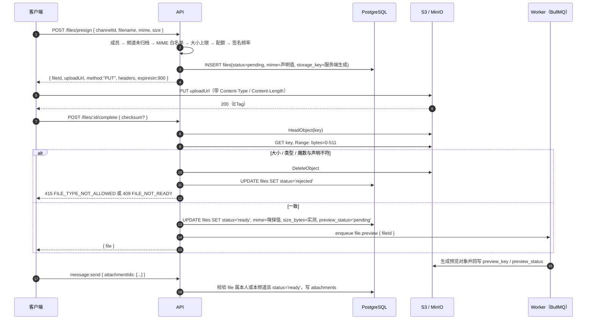

# 04 · 文件上传

> 协议编号：O.M.V-DJ / P-04　｜　版本：v1.0　｜　依据：`_contract.md` v1.0 §2.10 files、§9 限额、§10 直传流程。
> 管辖：预签名直传、完成校验、预览生成、访问签名、配额与孤儿清理。对象存储为 S3 兼容服务（MinIO 单节点，见 `10-部署拓扑.md`）。
> 一句话判据：**字节不经过应用进程**——API 只发签名、只校验元数据；唯一读对象内容的地方是 512 字节魔数嗅探。

| 参数 | 值 | 依据 |
| --- | --- | --- |
| 上传方式 | `PUT` 预签名 URL，签名内含 `content-length-range` | 契约 §10 |
| 签名有效期 | 900 s | 契约 §10 |
| 下载签名有效期 | 900 s（15 min） | 契约 §7 `GET /files/:id/url` |
| 签名频率 | 20 次/分钟/用户 | 契约 §9 |
| 嗅探窗口 | 对象前 512 字节 | 契约 §10 |
| 单频道素材 | 20 GB 软上限（提醒，不硬断） | 契约 §9 |
| bucket | 私有，无匿名读 | 安全默认 |

---

## 1. 全流程



规则：`status='pending'` 的文件不能挂到消息或卡片上（`FILE_NOT_READY`），否则频道会出现指向空对象的附件。

---

## 2. 预签名（POST /files/presign）

```ts
// 请求
{ "channelId": "uuid", "filename": "成品渲染_v3.png", "mime": "image/png", "size": 4812311 }

// 响应（契约 §10 字段固定，不增不减）
{ "fileId": "uuid", "uploadUrl": "https://s3.example.com/dijiang-uploads/ch/…?X-Amz-…",
  "method": "PUT", "headers": { "Content-Type": "image/png" }, "expiresIn": 900 }
```

**校验顺序**（任一失败即返回，不继续下一步）

| # | 校验 | 失败码 | 说明 |
| --- | --- | --- | --- |
| 1 | 登录且是频道成员（私密频道同样规则） | `NOT_CHANNEL_MEMBER` | 见 `05` §3 |
| 2 | 频道未归档、用户未被禁言 | `FORBIDDEN` / `MUTED` | 禁言拦写，含上传（契约 §4 规则 4） |
| 3 | `mime` 在 §3 白名单内 | `FILE_TYPE_NOT_ALLOWED` | 客户端声明仅作第一道筛选，不作结论 |
| 4 | `size` ≤ 该类型上限 | `FILE_TOO_LARGE` | 与签名 `content-length-range` 双重约束 |
| 5 | 频道用量未超软上限的 120 %（超限只提醒） | — | 软上限不阻断，见 §7 |
| 6 | `rl:presign:{userId}` 令牌桶 20/min | `RATE_LIMITED` | Redis + Lua |

**签名内容**

| 项 | 取值 | 理由 |
| --- | --- | --- |
| Key | `ch/{channelId}/{yyyy}/{mm}/{fileId}.{ext}` | 前缀按频道分域，便于配额统计与生命周期规则；扩展名由服务端按白名单映射，不取用户输入 |
| `content-length-range` | `[1, 类型上限]` | 让 S3 拒绝超限对象，避免「传完才发现太大」的带宽浪费 |
| `Content-Type` | 签名内固定，客户端必须原样发送 | 否则对象元数据与后续 HEAD 断言不一致 |
| 有效期 | 900 s | 大文件（200 MB）在 1–2 Mbps 上行约 15 分钟，留足余量 |
| 附加 | `x-amz-server-side-encryption` 视部署启停 | 不写死，交由 env |

`storage_key` 由服务端生成并入库（`storage_key UNIQUE`），客户端无法指定目标路径——这是防止越权覆盖他人对象的关键。

---

## 3. 类型与大小限制

| kind | 允许 MIME | 上限 | 魔数（前 512 字节） |
| --- | --- | --- | --- |
| image | `image/jpeg`、`image/png`、`image/webp`、`image/avif`、`image/heic` | 20 MB | `FF D8 FF`；`89 50 4E 47`；`RIFF….WEBP`；`ftypavif`；`ftypheic/heix` |
| video | `video/mp4`、`video/webm` | 200 MB | `….ftyp(isom/mp42)`；`1A 45 DF A3` |
| audio | `audio/mpeg`、`audio/mp4`、`audio/ogg`、`audio/wav` | 50 MB | `ID3`/`FF FB`；`ftypM4A`；`OggS`；`RIFF….WAVE` |
| document | `application/pdf`、`text/plain`、`text/markdown`、`application/zip`（及 docx/pptx/xlsx 的同一 OOXML 容器） | 100 MB | `%PDF-`；纯文本无魔数（按 UTF-8 探测）；`PK 03 04` |
| archive | `application/zip`、`application/x-7z-compressed` | 100 MB | `PK 03 04`；`37 7A BC AF 27 1C` |
| other | 不在以上白名单 | — | **不接受上传**，`FILE_TYPE_NOT_ALLOWED` |

说明：`application/zip` 同时落在 document 与 archive 两个 kind，`kind` 由「容器扩展名 + 声明 MIME」决定：`.zip` → archive，`.docx/.pptx/.xlsx` → document。`FileKind` 只有 6 个枚举值（契约 §1），不新增。

SVG **不在白名单**（`image/svg+xml` 不接收），理由见 §9。

### 3.1 对象存储 CORS（浏览器直传必需，易漏）

浏览器从 Web 前端（如 `http://localhost:3100`）直接 `PUT` 到对象存储，会先发 **OPTIONS 预检**；存储桶必须配置 CORS，否则浏览器会拦下请求（服务端完全看不到，表现为 `net::ERR_FAILED`）：

| 项 | 要求 |
| --- | --- |
| AllowedOrigin | 前端源白名单（开发 `http://localhost:3100`，生产 `https://dijiang.example.com`） |
| AllowedMethod | `PUT`、`GET`、`HEAD` |
| AllowedHeader | `content-type`（预签名时参与签名，必须允许）、`x-amz-*` |
| ExposeHeader | `ETag`、`Content-Length`、`Content-Range`、`x-amz-request-id` |
| MaxAgeSeconds | 600 |

S3 兼容 CORS 配置示例（MinIO / AWS S3 通用）：

```xml
<CORSConfiguration>
  <CORSRule>
    <AllowedOrigin>https://dijiang.example.com</AllowedOrigin>
    <AllowedMethod>PUT</AllowedMethod>
    <AllowedMethod>GET</AllowedMethod>
    <AllowedMethod>HEAD</AllowedMethod>
    <AllowedHeader>*</AllowedHeader>
    <ExposeHeader>ETag</ExposeHeader>
    <MaxAgeSeconds>600</MaxAgeSeconds>
  </CORSRule>
</CORSConfiguration>
```

> 本机 E2E 已改为 **rclone 1.75.2 的 S3 服务**（`127.0.0.1:9000`，`--allow-origin *`），预签名与 CORS 均由真实 S3 协议处理，不再使用 s3rver/CORS 代理。**生产部署必须给真实桶配 CORS，这一步不能省**。另外 `S3_PUBLIC_ENDPOINT` 必须是浏览器可达的地址（独立端口/子域），与 CORS 是两件不同的事。

---

## 4. 完成校验（POST /files/:id/complete）

| 步骤 | 动作 | 断言 |
| --- | --- | --- |
| 1 | `HeadObject` | `ContentLength` 存在且 ≤ 上限；`ContentType` 与签名一致 |
| 2 | 对比声明大小 | `abs(实际 - 声明) <= max(1024 B, 声明 × 1 %)`，防「声明 1 KB 实传 200 MB」 |
| 3 | `Range: bytes=0-511` 取头部 | 只读取前 512 字节，不下载整对象 |
| 4 | 魔数嗅探 → 真实 mime | 与声明分类一致（同 kind 内允许细节差异，如 jpeg→png 不允许） |
| 5 | 不一致 | `DeleteObject` → `status='rejected'` → 记 `audit_logs(action='file.reject')` |
| 6 | 一致 | 写回 `mime`（嗅探值）、`size_bytes`（实测）、`status='ready'`、`preview_status='pending'` |
| 7 | `checksum` 可选 | 传入则异步校验：Worker 流式计算 `sha256`，不符 → `rejected` |
| 8 | 幂等 | `complete` 可重复调用；`status='ready'` 时直接返回当前 file，不再 HeadObject |

**为什么还必须嗅探**：`Content-Type` 与扩展名都是客户端可伪造的输入，S3 只按签名内容存储、不校验语义；一份 `.png` 里放 HTML/JS 会在错误配置的下载路径上变成存储型 XSS 或钓鱼载体。服务端唯一的可信来源是字节。

---

## 5. 预览生成（Worker）

| 类型 | 处理 | 产物 | 失败降级 |
| --- | --- | --- | --- |
| image | `sharp` 解码 → 自动旋转（EXIF Orientation）→ 去元数据 → 输出 webp 三档 | 160 / 480 / 1280 宽，`preview_key = previews/{fileId}/{w}.webp` | `preview_status='failed'`，列表退回原图 |
| video | `ffmpeg -ss 1 -frames:v 1` 抽 poster，再用 `sharp` 缩放 | poster（1280 宽）+ 160 / 480 | 同上；视频仍可播放 |
| audio | 无封面则生成占位波形图（同尺寸 480） | 480 宽占位 | 同上 |
| document / archive | 不生成预览，`preview_status='none'` | 图标由前端按 mime 渲染 | — |
| heic / avif | `sharp` 依赖的 libheif 未必可用 | 可用则输出，不可用则 `failed` | 诚实降级：原图经 `GET /files/:id/url?variant=original` 打开 |

队列与重试：BullMQ 队列 `file.preview`，并发 1（Windows 单机 4C8G，ffmpeg 是 CPU 大头），指数退避重试 3 次，仍失败置 `failed` 并不再重试。`preview_key` 只在成功时写入，避免半成品对象被引用。

---

## 6. 访问签名（GET /files/:id/url）

| 项 | 规则 |
| --- | --- |
| 权限 | 请求者必须是该文件所属频道的成员；`owner_id` 本人始终可读自己的待发文件 |
| `variant=preview` | 有预览返回预览对象签名 URL；无预览降级原图（契约 §10 第 5 步） |
| 有效期 | 900 s，URL 不落库、不缓存、不下发给非成员 |
| 响应 | 302 或 JSON `{ url, expiresAt }`；前端 `` 直连，不经代理 |
| 私有性 | bucket 无公网读策略，对象只有签名 URL 一条访问路径 |

---

## 7. 配额

| 项 | 值 | 行为 |
| --- | --- | --- |
| 单频道软上限 | 20 GB | 达到 80 % 在素材库顶部提示；达到 100 % 提示并写入 `audit_logs`；**不拒收** |
| 统计口径 | `SELECT sum(size_bytes) FROM files WHERE channel_id=$1 AND status='ready'` | 走 `files_archive` 索引，一次聚合 |
| 全局 | 磁盘 > 70 % 由运维告警处理（见 `10` §4） | 应用层不做全局硬配额 |
| 单文件 | 见 §3 表 | 签名期与完成期各校验一次 |

软上限的理由（一句）：这是 8–20 人社团的共享盘，硬断会让「上传失败」成为协作阻塞；提醒 + 审计把处置权交给协议官。

---

## 8. 孤儿文件清理

| 状态 | 判定 | 处置 | 周期 |
| --- | --- | --- | --- |
| `pending` 且超 24 h | `status='pending' AND created_at < now()-'24 hours'` | 删对象 → `status='deleted'` | 每小时 |
| `rejected` | 完成校验或异步校验失败 | 对象已删，行保留 30 天后清 | 每日 |
| `deleted` | 行保留 | 30 天后物理删行 | 每日 |
| `ready` 但无附件引用且超 7 天 | `NOT EXISTS (SELECT 1 FROM attachments a WHERE a.file_id=f.id)` 且 `files.channel_id IS NULL` | 删对象 → `deleted` | 每日 03:30 |
| 对象存在但库内无行 | 前缀扫描 `ch/` 对比 `select storage_key` | 仅记日志告警，不自动删（可能是清理竞态） | 每周 |

```sql
-- 每日 03:30 的引用检查（先软删，再由生命周期兜底）
UPDATE files f SET status = 'deleted'
WHERE f.status = 'ready' AND f.channel_id IS NULL AND f.created_at < now() - interval '7 days'
  AND NOT EXISTS (SELECT 1 FROM attachments a WHERE a.file_id = f.id);
```

删除顺序固定为**先删对象、后改状态**：对象删除失败时事务回滚，行保持原状，下一轮重试；反之会留下无主对象。

---

## 9. 安全考量

| 风险 | 处置 |
| --- | --- |
| SVG（`image/svg+xml`） | 白名单外，不接受；即便将来放开，也必须校验后重编码为位图再提供下载 |
| zip 炸弹 | 服务端从不解压归档；只读 512 字节魔数。下载由客户端自行承担解压风险 |
| EXIF / GPS 泄露 | 预览走 `sharp` 重编码，默认丢弃全部元数据；原图保真不动，是否脱敏在下载侧提示 |
| 文件名注入 | `original_name` 仅作展示：剥离路径分隔符与控制字符、截断 255；对象键完全由服务端生成 |
| 解码炸弹（超大像素） | `sharp({ limitInputPixels: 64_000_000 })`；视频抽帧加 `-t`/超时 30 s 限制 |
| 类型混淆 / 存储型 XSS | 私有 bucket + 短签名 + `Content-Disposition: attachment`（非图片版）；魔数校验兜底 |
| 越权覆盖 | `storage_key` 服务端生成，客户端无法指定 |
| 越权读取 | `GET /files/:id/url` 每次校验频道成员，不签发长期 URL |
| 恶意大文件 | `content-length-range` + 完成期 HEAD 双重拦截 |
| 病毒扫描 | **不在本期范围**（无 Docker / 无 AV 服务）；以「不执行、不解析、私有访问」降低暴露面 |

---

## 10. 错误码

| 场景 | 码 | HTTP |
| --- | --- | --- |
| 类型不在白名单 | `FILE_TYPE_NOT_ALLOWED` | 415 |
| 声明或实测超上限 | `FILE_TOO_LARGE` | 413 |
| 未完成上传 / 校验未过 / 文件被撤回 | `FILE_NOT_READY` | 409 |
| 非频道成员 | `NOT_CHANNEL_MEMBER` | 403 |
| 禁言中 | `MUTED`（附 `until`） | 403 |
| 签名频率超限 | `RATE_LIMITED`（附 `retryAfterMs`） | 429 |
| 字段缺失或非法 | `VALIDATION_FAILED` | 400 |

---

## 11. 取舍记录

| 议题 | 采用 | 理由（一句） | 备选与代价 |
| --- | --- | --- | --- |
| 传输路径 | 预签名直传 | API 不承载字节，200 MB 视频不占 Node 内存与带宽 | 服务端中转：可在流中做完整校验，但要扛住并发的 200 MB 流，单机风险更高 |
| 校验深度 | HeadObject + 512 B 魔数 | 一次对象请求完成，毫秒级 | ClamAV 全文件扫描：可信度更高，但需部署扫描服务与数分钟延迟 |
| 预览 | 异步队列（BullMQ） | `complete` 立即返回，不阻塞消息发送 | 同步生成：接口稳定但 P95 会被 ffmpeg 拉到秒级 |
| 预览格式 | webp 三档 | 一张源图仅存 3 个衍生对象，体积约为原图 15 % | jpeg + 多尺寸：兼容性略好，体积更大；按需实时缩放：CPU 抖动 |
| 配额 | 软上限 + 提醒 | 不给协作流程加硬失败点 | 硬配额：可预测磁盘，但会阻断上传 |
| 清理 | 状态机 + 定时任务 | 每个状态都有明确回收路径 | 仅靠 MinIO 生命周期：无法区分 pending 与已引用对象 |
| 存储键 | 服务端生成 | 客户端无法覆盖或猜中他人对象 | 客户端提供 key：需额外签名域限制与冲突处理 |

---

## 12. 已识别薄弱点

1. **HEIC / AVIF 预览不可保证**：取决于 Windows 上 `sharp` 的 libheif 编译状态；不可用时只能降级原图，iPhone 素材在素材库里的缩略图体验会明显变差。
2. **无病毒 / 恶意内容扫描**：本机无 Docker，跑不起独立扫描服务；当前只靠「不解析、私有访问、强制下载」降低暴露面，属于缓解而非消除。
3. **配额不硬断**：20 GB 软上限意味着磁盘写满仍是真实风险，需依赖运维告警与手动清理，应用层不兜底。
