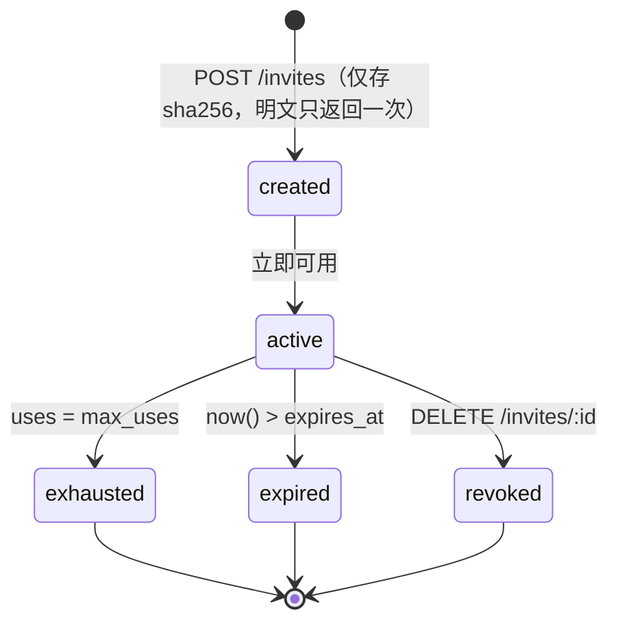

# 05 · 权限模型

> 协议编号：O.M.V-DJ / P-05　｜　版本：v1.0　｜　依据：`_contract.md` v1.0 §1 枚举、§4 权限矩阵、§5 邀请码生命周期、§8 错误码。
> 管辖：授权判定（谁能做什么）、可见性、禁言、邀请码准入。不定义业务规则（如「15 分钟内可编辑」由消息服务自己判）。
> 一句话判据：**判定是一个纯函数 + 两条 SQL 查询**，不引入策略引擎。

---

## 1. 角色与维度

| 维度 | 取值 | 作用域 | 谁可变更 | 存储位置 |
| --- | --- | --- | --- | --- |
| 全局角色 | `owner` / `admin` / `member` | 全站 | owner（admin 仅可改 member↔admin） | `users.global_role` |
| 频道角色 | `member` / `moderator` | 单频道 | owner / admin / 该频道 moderator（不可移除 moderator，契约 §4） | `channel_members.role` |
| 可见性 | `public` / `private` | 单频道 | owner / admin | `channels.visibility` |
| 全站禁言 | `muted_until` | 全站 | owner / admin | `users.muted_until` |
| 频道禁言 | `muted_until` | 单频道 | owner / admin / 频道 moderator | `channel_members.muted_until` |
| 账号状态 | `active` / `suspended` | 全站 | owner / admin | `users.status` |
| 准入 | 邀请码 | 全站 | owner / admin | `invites`（§6） |

三条结构性结论：

1. **全局角色不隐含频道权限**。owner 与 admin 默认**不是**任何私密频道成员，看不到其消息（契约 §4 规则 2）。
2. **moderator 只在所属频道内有效**，不跨频道（契约 §4 规则 3）。
3. **禁言是时间维度，不是角色**。`muted_until` 过期即自动解除，无需定时任务。

---

## 2. 权限矩阵

与契约 §4 逐行一致，未增删。列顺序：owner / admin / member / 非成员。

| 操作 | owner | admin | member | 非成员 |
| --- | --- | --- | --- | --- |
| 读公开频道消息 | ✅ | ✅ | ✅ | ❌ |
| 读私密频道消息 | 仅本人是成员 | 仅本人是成员 | 仅本人是成员 | ❌ |
| 发消息 | ✅ | ✅ | 需频道成员 | ❌ |
| 编辑自己的消息 | ✅ | ✅ | ✅ | ❌ |
| 删除他人消息 | ✅ | ✅ | 仅频道 moderator | ❌ |
| 置顶 | ✅ | ✅ | 仅频道 moderator | ❌ |
| 建频道 | ✅ | ✅ | ❌ | ❌ |
| 管理频道成员 | ✅ | ✅ | 仅频道 moderator（不可移除 moderator） | ❌ |
| 创建邀请 | ✅ | ✅ | ❌ | ❌ |
| 封禁用户 / 改全站角色 | ✅ | 仅 member↔admin | ❌ | ❌ |
| 创建卡片 / 投票 / 任务 | ✅ | ✅ | 需频道成员 | ❌ |
| 删除他人卡片 | ✅ | ✅ | 仅频道 moderator 或卡片作者 | ❌ |
| 查看私密频道元数据 | ✅（列表可见名称，不可读消息） | ✅ | 仅成员 | ❌ |

补充口径（契约未展开、但接口需要）：

| 项 | 口径 | 理由 |
| --- | --- | --- |
| 「成员」的含义 | `channel_members` 有行即成员，公开频道也一样 | 矩阵中「非成员 ❌ 读公开频道消息」已明确：公开只影响可见性，不替代入频道 |
| 编辑窗口 | 作者本人 15 分钟内（契约 §7） | 超时返回 `FORBIDDEN`，不改矩阵 |
| 删除卡片 | 卡片作者与 moderator 同权 | 与「删除他人消息」保持同一心智 |
| 归档频道 | 可读，禁写（发言 / 建卡 / 上传） | 归档是软删除的中间态（见 `02` §2.6） |
| 系统消息 `kind=system` | 仅服务端可写，任何角色不可发 | 防伪造 |

---

## 3. 判定顺序与伪代码

判定顺序由契约 §4 规则 1 固定：**登录 → 全站封禁 → 可见性 → 频道成员 → 禁言 → 业务规则**。前五步共用一个函数，业务规则由各服务自行追加。

```ts
type Action = 'read' | 'write' | 'admin';
type Ctx = { user: User | null; channel?: Channel; member?: ChannelMember | null };

export function decide(ctx: Ctx, action: Action): Decision {
  const { user, channel, member } = ctx;

  // 1 登录
  if (!user) return deny('AUTH_REQUIRED');
  // 2 全站封禁（含登录态被撤销）
  if (user.status === 'suspended') return deny('FORBIDDEN');

  // 3 与频道无关的管理动作：建频道 / 邀请 / 封禁 / 改角色
  if (action === 'admin')
    return user.global_role === 'owner' || user.global_role === 'admin'
      ? allow() : deny('FORBIDDEN');

  if (!channel) return allow();                       // 与频道无关的读（/users、/me …）
  if (channel.archived_at && action !== 'read') return deny('FORBIDDEN');

  // 4 可见性：private 且非成员，连元数据都不给（owner/admin 由上层列表查询放行名称）
  if (channel.visibility === 'private' && !member) return deny('NOT_CHANNEL_MEMBER');

  // 5 频道成员：公开频道同样要求入频道
  if (!member) return deny('NOT_CHANNEL_MEMBER');

  // 6 禁言只拦写（发消息 / 建卡 / 投票 / 上传）
  if (action === 'write') {
    const until = maxTime(user.muted_until, member.muted_until);
    if (until && until.getTime() > Date.now()) return deny('MUTED', { until });
  }

  return allow();                                     // 7 业务规则交给调用方
}

export const canModerate = (ctx: Ctx) =>
  ctx.user?.global_role === 'owner' || ctx.user?.global_role === 'admin' ||
  ctx.member?.role === 'moderator';
```

调用侧只做两件事：查 `channel_members`（走主键，一次索引查询），再按需追加 `canModerate` 或作者判定：

| 动作 | 追加判定 |
| --- | --- |
| 删他人消息 / 置顶 / 管理成员 | `canModerate(ctx)` |
| 编辑 / 删除自己的消息 | `message.sender_id === user.id && now - created_at <= 15min` |
| 删除他人卡片 | `canModerate(ctx) \|\| card.created_by === user.id` |
| 改全站角色 | `user.id !== target.id` 且角色变更方向合法（admin 只能 member↔admin） |
| 移除频道成员 | `canModerate(ctx)` 且目标 `role !== 'moderator'` |
| 撤销邀请 | `global_role ∈ {owner, admin}` 或 `invites.created_by === user.id` |

统计：主体 `decide` 31 行，无嵌套超过 2 层，无 I/O（查询在调用方完成），满足「≤40 行」约束。

---

## 4. 可见性

| 可见性 | 元数据（名称 / slug / 成员数 / 话题） | 消息、卡片、文件、搜索 | 谁可见于 `GET /channels` |
| --- | --- | --- | --- |
| `public` | 所有登录用户 | 仅成员 | 所有登录用户（含未加入者，可点击但无内容） |
| `private` | owner / admin / 成员 | 仅成员 | owner / admin / 成员 |

实现约束：

- `GET /channels` 的 SQL 必须显式拼接可见性条件，不能只靠「未加入就不返回」，否则 owner 看不到私密频道名称、与矩阵最后一行冲突：

```sql
SELECT c.*, cm.last_read_seq, cm.role
FROM channels c
LEFT JOIN channel_members cm ON cm.channel_id = c.id AND cm.user_id = $1
WHERE c.archived_at IS NULL
  AND (cm.user_id IS NOT NULL OR c.visibility = 'public' OR $2 IN ('owner','admin'))
ORDER BY c.position, c.created_at;
```

- 私密频道的**内容**端点（消息、卡片、文件、搜索）一律先过 `decide(..., 'read')`，不做「管理员例外」。
- 未读数与 `last_read_seq` 只对成员有意义：非成员返回 `0`，不泄露消息数量。
- `GET /channels/:id` 对私密频道非成员返回 404 `CHANNEL_NOT_FOUND`，而非 403——不确认频道存在性。

---

## 5. 禁言

| 层级 | 字段 | 生效范围 | 设置者 |
| --- | --- | --- | --- |
| 全站 | `users.muted_until` | 所有频道的写操作 | owner / admin |
| 频道 | `channel_members.muted_until` | 该频道的写操作 | owner / admin / 频道 moderator |

规则：

1. 两个 `muted_until` 取**较晚者**生效（`max`），不是相互覆盖。
2. 只拦写：发消息、建卡、投票、上传、发反应。**不拦读**（契约 §4 规则 4）。
3. 拒绝载荷带 `until`（ISO 8601），前端据此置灰输入框：`MUTED` + `{ until }`（契约 §8）。
4. 过期自动失效，无需清理任务；`muted_until` 为过去时间等价于未禁言。
5. moderator 可被禁言，但不可被同级 moderator 移除（契约 §4）。

---

## 6. 邀请码生命周期



| 状态 | 判定条件 | 注册是否可用 |
| --- | --- | --- |
| created / active | `revoked_at IS NULL AND expires_at > now() AND uses < max_uses` | ✅ |
| exhausted | `uses >= max_uses` | ❌ |
| expired | `now() >= expires_at`（默认 7 天） | ❌ |
| revoked | `revoked_at IS NOT NULL`（立即生效，已注册用户不受影响） | ❌ |

状态是**派生的**，不落库（见 `02` §2.5）：四个字段足以表达全部状态，额外状态列只会引入一致性风险。

**注册事务**（契约 §5：校验 → 建用户 → 计数 → 建会话，单事务）

```sql
BEGIN;
-- 原子占用一个名额：0 行即失败，不需先 SELECT
UPDATE invites SET uses = uses + 1
 WHERE code_hash = $1 AND revoked_at IS NULL AND expires_at > now() AND uses < max_uses
 RETURNING id, role;
INSERT INTO users (handle, display_name, password_hash, global_role) VALUES (...) RETURNING id;
INSERT INTO user_settings (user_id) VALUES ($new);
INSERT INTO sessions (user_id, token_hash, ip, user_agent, expires_at) VALUES (...);
INSERT INTO audit_logs (actor_id, action, target_kind, target_id, meta)
VALUES ($new, 'invite.redeem', 'invite', $inviteId, '{"code_prefix":"AB12"}');
COMMIT;
```

| 规则 | 值 | 理由 |
| --- | --- | --- |
| 默认 | 1 次、7 天、角色 `member` | 契约 §5 |
| 明文存储 | 仅入库 `sha256(大写)`，原文只返回一次 | 库泄漏也不能直接开户 |
| 识别 | `code_prefix` 前 4 位，管理台展示与排错用 | 不牺牲可用性 |
| 邀请预览 | `GET /invites/:code/preview`（公开）只回「是否有效 + 邀请人显示名」 | 不泄露 `role / uses / expires_at` |
| 失败口径 | 不存在 / 已过期 / 已用尽 / 已撤销统一 `INVITE_INVALID` | 不提供枚举探测信息 |
| 频率 | 同一 IP 10 分钟内最多 5 次尝试（`rl:invite:{ip}`） | 契约 §5 |
| 撤销 | 立即生效，不影响已注册用户 | 契约 §5 |
| 角色上限 | 邀请只能产出 `member` / `admin`，不能产出 `owner` | owner 唯一（契约 §4 规则 5） |

---

## 7. 为什么不做完整 RBAC

需求侧只有 **2 个全局角色 × 2 个频道角色 × 2 个可见性 + 1 个时间维度**，共 8 种有效组合。完整 RBAC（`roles` / `permissions` / `role_permissions` / `user_roles` 四表 + 策略缓存 + 管理界面）需要为 8 个组合维护一套通用机制。

| 维度 | 硬编码判定（采用） | 完整 RBAC |
| --- | --- | --- |
| 表数量 | 0 张新表 | 4 张 |
| 判定耗时 | 纯函数 + 1 次主键查询，< 1 ms | 需加载策略（或缓存失效）后再判定 |
| 变更成本 | 改一行代码 + 发版 | 管理台操作即可，但需要先建管理台 |
| 表达力 | 覆盖当前 100 % 需求 | 覆盖未来 10 倍需求 |
| 风险 | 需求膨胀后函数变长 | 过度设计，权限语义散落在数据里难以 review |

升级触发条件（任一成立再引入）：
1. 出现第 4 种全局角色，或需要「频道级自定义权限」（如某频道禁止上传）。
2. 需要按人授予临时权限（当前只有时间维度的禁言，方向相反）。
3. 多租户化——此时权限的隔离维度不再是「频道」而是「租户」。

备选方案与代价：Casbin（策略文件 + adapter，适合规则频繁变动）、ABAC（属性判定，适合多租户但调试成本高）。两者都会把一条可读的 `if` 变成一层配置解析，当前不划算。

---

## 8. 取舍记录

| 议题 | 采用 | 理由（一句） | 备选与代价 |
| --- | --- | --- | --- |
| 判定结构 | 纯函数 + 调用方查库 | 无 I/O 便于单测；查询计划显式可见 | 中间件全包：一次判定所有端点，但容易吞掉「作者本人」这类业务例外 |
| 管理员可见性 | 私密频道内容对 admin 不可见 | 「管理员偷看」是社团协作的信任红线（契约 §4 规则 2） | 管理员全可见：运维排查方便，但破坏私密语义 |
| 私有频道 404 | 非成员返回 `CHANNEL_NOT_FOUND` | 不确认存在性 | 返回 403：语义更准，但泄露频道存在 |
| 禁言 | 时间字段，两级取 max | 过期自动失效，无需定时任务 | 布尔 + 定时解禁：需要可靠调度，失败即永久禁言 |
| 邀请状态 | 派生不落库 | 四个字段已完备，无状态漂移 | 状态列 + 触发器：查询略快，但存在双写不一致 |
| 授权模型 | 硬编码规则 | 8 种组合，通用机制成本高于收益 | 完整 RBAC / Casbin：见 §7 |

---

## 9. 已识别薄弱点

1. **「不可移除 moderator」只靠应用层**：DB 无约束，误写的管理脚本可以直接删行；当前以 `audit_logs` 事后追溯兜底。
2. **管理员可见性依赖每条查询自觉**：`GET /channels` 的可见性条件由 SQL 拼装，新增列表端点（如「推荐频道」）时若忘记带上条件，会泄露私密频道名称；没有统一的查询构造器强制。
3. **邀请预览端点无需登录**：`GET /invites/:code/preview` 公开，配合前缀可做低成本的「码是否存在」探测；仅靠 5 次/10 分钟/IP 限速，IPv6 或代理池可绕。
