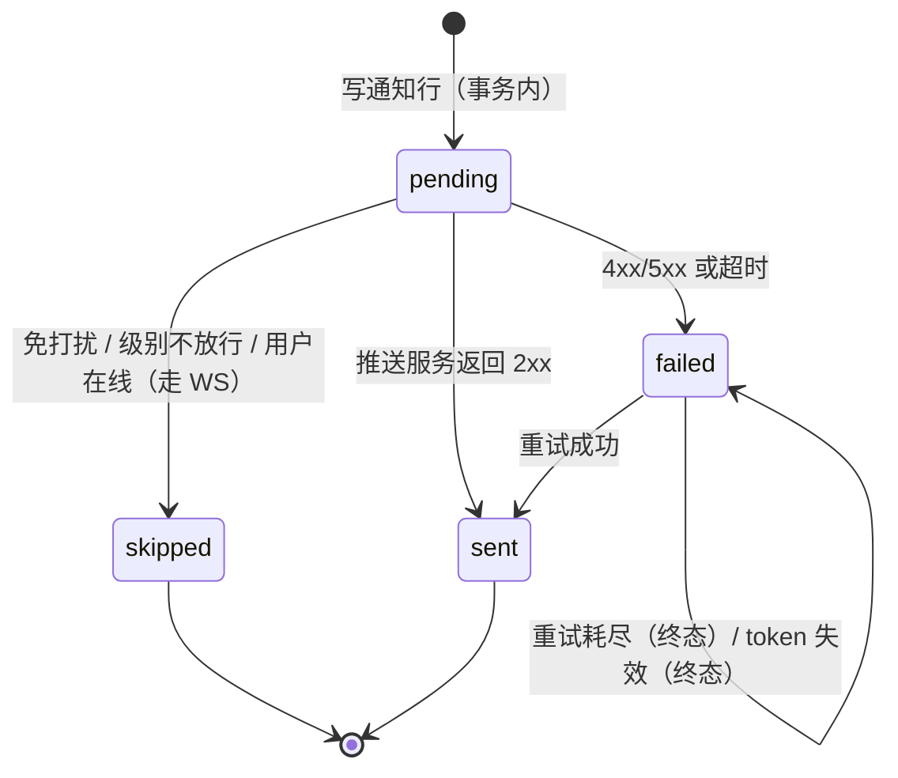

# 07 · 通知与免打扰

> 协议编号：O.M.V-DJ / P-07　｜　版本：v1.0　｜　依据：`_contract.md` v1.0 §1 `NotificationType` / `PushStatus`、§2.17 notifications、§2.2 / §2.7 通知级别、§9 限额、§12 验收数据。
> 管辖：通知的产生、去重与聚合、免打扰判定、通道选择、投递重试与失效清理。消息本身的可达性由 `03` 负责，本文件只管「要不要提醒、怎么提醒」。
> 一句话判据：**站内记录一定有，推送不一定**；`read_at`（用户行为）与 `push_status`（投递结果）永不互相推断。

---

## 1. 通道与职责

| 通道 | 触发条件 | 载荷 | 失败影响 |
| --- | --- | --- | --- |
| `notifications` 行 | 触发矩阵命中 | `title ≤120` / `body ≤300` / `payload` | 无，写库即可 |
| WS `notification:new` | 用户有活跃 socket | `{ notification }` | 无，站内仍有记录 |
| Web Push | 无活跃 socket 且 `push_web=true` | 标题 + 摘要 + 跳转 URL | 记 `failed` 并重试 |
| FCM | 无活跃 socket 且 `push_android=true` | data message（跳转参数） | 同 Web Push |
| 站内红点 | `GET /notifications/unread-count` | 计数 | — |

不做的通道：邮件、短信、第三方 IM（`01` G7 已确认仅站内与推送）。

---

## 2. 触发矩阵

| type | 触发点 | 接收人 | 优先级 | 聚合 | 免打扰内 |
| --- | --- | --- | --- | --- | --- |
| （普通消息） | 频道内 `message:new` | **不产生通知行** | — | — | 仅未读累计，见 §2 边界 1 |
| `mention` | 消息 `mentions` 含该用户 | 被 @ 的频道成员 | P0 | 不聚合 | **仍推送** |
| `thread_reply` | 回复的根线程有该用户参与 | 根作者 + 曾回复者（去重、排除操作者本人） | P1 | 300 s 合并 | 静默 |
| `card_assigned` | `card_assignees` 新增行 | 被指派者 | P0 | 不聚合 | **仍推送** |
| `card_due` | 定时扫描 `cards.due_at` 到期 | 任务指派者 | P1 | 每日 09:00 汇总一条 | 顺延到静默结束 |
| `vote_closed` | 投票 `closed_at` 到达 / 手动关闭 | 频道内参与过该投票者 | P2 | 300 s 合并 | 顺延 |
| `invite_accepted` | 注册成功 | 邀请码 `created_by` | P2 | 不聚合 | 顺延 |
| `system` | 封禁、角色变更、频道归档等管理动作 | 受影响用户 | P1 | 300 s 合并 | 静默 |

三条边界：

1. **普通消息不产生通知行**。频道里每条 `message:new` 都写通知会把 30 万条消息变成 30 万行通知，且枚举里没有「普通消息」类型（契约 §1）。
2. **自己触发的事件不通知自己**：自己发的消息、自己指派自己、自己的投票截止均跳过。
3. **`system` 不特殊放行**：它同样受 `notify_level` 与免打扰约束。管理动作的**站内可见性**由通知行保证（照常写库、红点累计），但不以推送叫醒用户；封禁等安全事件在登录页/会话失效提示中另行告知，不依赖推送。

---

## 3. 通知级别解析

`NotifyLevel = all | mentions | none`，频道级（`channel_members.notify_level`）覆盖全站级（`user_settings.notify_level`）。枚举中没有「普通消息」类型，因此三个级别的差异体现在**放行哪些 type**：

| 生效级别 | 放行类型 | 说明 |
| --- | --- | --- |
| `all` | 全部 7 类 | 默认 |
| `mentions` | `mention`、`thread_reply`、`card_assigned` | 只留「直接指向我」的三类 |
| `none` | 无 | 全部静默，通知行照常写库、未读照常累计 |

† 口径：`card_assigned` 归入 `mentions` 是有意选择——指派与 @ 同为「有人直接交给我一件事」，若归入 `all`，`mentions` 级别会漏掉被指派的待办。此项需在契约 v1.1 明确。

```ts
function effectiveLevel(user: UserSettings, member?: ChannelMember): NotifyLevel {
  return member?.notify_level ?? user.notify_level;   // 频道覆盖全站
}
function allowed(type: NotificationType, level: NotifyLevel): boolean {
  if (level === 'all') return true;
  if (level === 'mentions') return type === 'mention' || type === 'thread_reply' || type === 'card_assigned';
  return false;                                        // none
}
```

---

## 4. 优先级与聚合

| 优先级 | 含义 | 行为 |
| --- | --- | --- |
| P0 | 直接指向我 | 立即投递，不聚合；免打扰内仅 `mention` 仍推送，`card_assigned` 顺延到静默结束 |
| P1 | 我参与的话题有进展 | 进入聚合窗口，窗口结束合并投递 |
| P2 | 结果类、知会类 | 进入聚合窗口，弱化（不弹系统通知，仅 WS 与红点） |

聚合规则：

| 项 | 规则 |
| --- | --- |
| 窗口 | `user_settings.digest_window`，默认 **300 s**（契约 §2.2） |
| 合并键 | `(user_id, type, channel_id, card_id)` |
| 合并内容 | 保留首条 `id`，累加 `payload.mergedIds`、`payload.count`，`title` 改为「N 条新回复」 |
| 窗口过期 | 由 BullMQ 延迟任务触发，任务键 = 合并键；同一键重复入队被去重 |
| 上限 | 单窗口最多合并 50 条，超出改为「50+ 条」，避免 payload 无界 |
| 去重 | 同一 `(type, message_id, user_id)` 不产生第二行（`message_id` 天然唯一） |

```ts
// 合并后的通知行（payload 承载合并信息，不新增字段）
{
  "type": "thread_reply",
  "title": "「素材归档规范」有 4 条新回复",
  "body": "最后一条：v3 的色板已更新，请复核",
  "payload": { "rootId": "123", "mergedIds": ["124", "125", "126", "127"], "count": 4 }
}
```

---

## 5. 静默时段

| 项 | 规则 |
| --- | --- |
| 字段 | `dnd_enabled`、`dnd_start`、`dnd_end`（`time` 类型，本地时间）、`timezone`（IANA） |
| 判定 | 用 `timezone` 把 `now()` 转本地 `HH:mm:ss`，再比较区间；不依赖客户端时区 |
| 跨零点 | `dnd_start > dnd_end` 视为跨零点区间（如 22:00–08:00） |
| 边界 | 左闭右开 `[start, end)`；`start == end` 视为未启用 |
| 静默期内 | 通知行照常写库（`read_at=NULL`），`push_status='skipped'`，**不发** Web Push / FCM |
| 例外 | 仅 `mention` 仍推送（`01` §5「非提及消息不产生推送」）；`card_assigned`、`system` 静默顺延 |
| 结束 | 不批量补推。用户回站时 `GET /notifications?unread=true` 与 `notification:new` 的 WS 摘要即为补偿 |
| 摘要 | 静默期结束时若用户在线的下一分钟，允许一条聚合摘要（P2），每条静默期最多 1 条 |

```ts
function inDnd(s: UserSettings, now = new Date()): boolean {
  if (!s.dnd_enabled || !s.dnd_start || !s.dnd_end) return false;
  const t = localHms(now, s.timezone);            // '22:30:00'
  const [a, b] = [s.dnd_start, s.dnd_end];
  return a <= b ? t >= a && t < b : t >= a || t < b;   // 跨零点取并集
}
```

理由（一句）：静默期只抑制推送、不抑制记录，是因为「不打扰」的语义是「别叫醒我」，不是「别告诉我」。

---

## 6. 通道选择

| 用户状态 | WS | Web Push | FCM | 说明 |
| --- | --- | --- | --- | --- |
| 在线（`presence:{id}` 存在） | ✅ 立即 | ❌ | ❌ | 在线时仅 WS，避免同一条通知出现两次 |
| 离线，有活跃 web 设备 | — | ✅ | ❌ | `push_web=true` |
| 离线，有 Android 设备 | — | ❌ | ✅ | `push_android=true` |
| 离线，两者都有 | — | ✅ | ✅ | 各平台各自投递，客户端按 `tag` 折叠 |
| 无设备 / 全部失效 | — | ❌ | ❌ | `push_status='failed'`，仅站内 |

折叠与去重：

| 平台 | 机制 | 值 |
| --- | --- | --- |
| Web Push | `tag` | `channel:{channelId}`，同频道只留最新一条 |
| FCM | `collapse_key` + `tag` | 同上；`android.notification.tag` 保证替换而非堆叠 |
| 跳转 | `data.url` | 前端路由 `/channels/{id}?m={messageId}`（非 API 路径），冷启动可直接定位 |

在线判定读 Redis（`03` §6），**不读数据库**：离线判定错一次的代价只是一条多余推送，代价可接受；反过来每推一条就查一次 `devices` 表才是问题。

---

## 7. 投递状态机



| 状态 | 含义 | 依据 |
| --- | --- | --- |
| `pending` | 已入库，待投递 | 默认值（契约 §2.17） |
| `sent` | 推送服务已接受（不代表已展示） | `pushed_at` 同事务写入 |
| `failed` | 投递失败且重试耗尽，或设备 token 失效 | 终态 |
| `skipped` | 有意不投递（在线 / 免打扰 / 级别） | 不是错误 |

重试策略：

| 项 | 值 |
| --- | --- |
| 最大尝试 | 5 次 |
| 退避 | 30 s → 2 min → 10 min → 1 h → 6 h（指数 + 抖动） |
| 重试计数存放 | Redis `push:retry:{notificationId}`（TTL 24 h） |
| 为何不入库 | 契约 §2.17 没有 attempts 字段，不为了重试加列；重启丢计数最多多推一次，被 `tag` 折叠吸收 |
| 终态判定 | Web Push `404/410` → 设备失效；FCM 侧 `UNREGISTERED` / `INVALID_ARGUMENT` reason → 失效；其余 5xx 走重试 |
| 批量 | Worker 按用户聚合，同一批同一频道只发 1 条（折叠） |

---

## 8. 失效 token 清理

| 信号 | 动作 |
| --- | --- |
| Web Push `404` / `410 Gone` | 删除 `devices` 行（`push_token` 不可再投递） |
| FCM `UNREGISTERED` / `INVALID_ARGUMENT` | 同上 |
| 用户主动关闭推送 | 只改 `user_settings.push_web/push_android`，保留设备 |
| 设备 90 天无 `last_active_at` | 定时任务清理（与 `DELETE /me/devices/:id` 同效） |
| 清理后该用户无任何设备 | 后续通知直接 `skipped`（不写 `failed`，避免噪声） |

删除设备行会 `SET NULL` 掉 `sessions.device_id`（见 `02` §2.4），不影响已登录会话。

---

## 9. 保留与清理

| 数据 | 保留 | 处置 |
| --- | --- | --- |
| 已读通知（`read_at IS NOT NULL`） | 90 天 | 物理删除（`notifications_gc` 索引） |
| 未读通知 | 不设期限 | 用户自己读；超过 180 天仍未读的合并为一条「历史未读」 |
| `push_status='failed'` | 30 天 | 删除，减少管理台噪声 |
| 聚合 payload | 随行 | 无独立表 |

清理任务每日 04:00，单次 `DELETE ... LIMIT 5000` 循环，避免长事务锁表。

---

## 10. 推送频率闸门

| 闸门 | 值 | 超限行为 |
| --- | --- | --- |
| 单用户推送 | 10 分钟内 ≤5 条 | 超出部分合并为 1 条摘要（P2） |
| 单频道广播 | 同一秒 ≤1 条 | 折叠（`tag = channel:{id}`） |
| 全局 | 每秒 ≤50 条 | Worker 排队，不丢弃 |

理由（一句）：推送通道是唯一会「打扰到人」的资源，宁可延迟合并，不可瞬时轰炸。

---

## 11. 取舍记录

| 议题 | 采用 | 理由（一句） | 备选与代价 |
| --- | --- | --- | --- |
| 通知模型 | 只记 6 类事件，普通消息不记 | 行数与消息量解耦，30 万条消息不产生 30 万行通知 | 每条消息都记：红点精确但表爆炸，且无法解释「为什么提醒我」 |
| 聚合实现 | 延迟任务 + 合并键 | 同一话题的多次回复收敛为一条，可解释 | 定时批量扫描：实现简单，但窗口不精确（固定 5 分钟粒度） |
| 免打扰 | 只抑制推送 | 「别叫醒我」不等于「别告诉我」 | 连站内也不写：语义更彻底，但用户回站看不到发生了什么 |
| 在线判定 | Redis presence | 读一次 O(1)，不增加 DB 负载 | 查连接表：准确，但每推一条多一次查询 |
| 多端 | 在线走 WS、离线各平台推 | 避免同一条通知出现两次 | 全平台都推：覆盖好，但手机上会收到电脑前已读的通知 |
| 重试计数 | Redis 不入库 | 不为重试改契约表结构 | 加 `attempts` 列：可观测性更好，但属契约变更 |
| 静默期结束 | 不补推 | 早晨一次收到十条推送比没收到更糟 | 补推：不丢信息，但制造集中打扰 |

---

## 12. 已识别薄弱点

1. **在线判定与多设备合并有误差**：用户电脑在线、手机离线时，按「在线仅 WS」只发 WS，手机不会响；若用户离开电脑，这条通知事实上没被看到。要修需要「按设备在线」的状态（契约 `presence:update` 只有用户级两态）。
2. **重试计数在 Redis**：进程重启或 Redis 清空会重置退避，极端情况下同一条通知可多推一次；靠 `tag` 折叠吸收，但没有硬保证。
3. **`card_due` 依赖定时扫描**：扫描间隔（建议 10 分钟）与「每日 09:00 汇总」意味着截止提醒最多晚 10 分钟、汇总类最多晚一天；对「今天到期的任务」这是可接受的，对分钟级截止不是。
