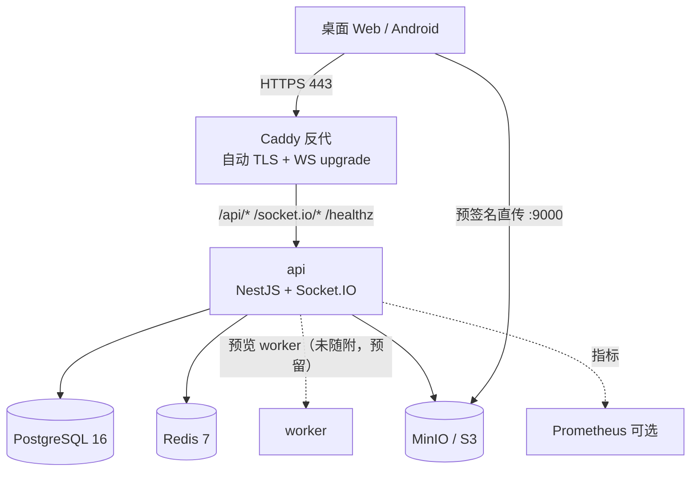
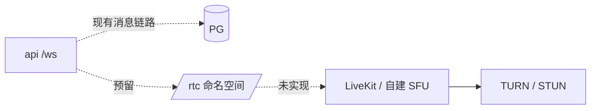

# 10 · 部署拓扑

> 协议编号：O.M.V-DJ / P-10　｜　版本：v1.0
> 原则：**一台机器能跑起来，两台机器能扩**。所有组件都能单机起、都能换托管。

---

## 1. 拓扑 A：单机自托管（8–20 人，最小可用）



一台 4C8G / 200GB SSD 的 Linux 主机，全部 Docker Compose。峰值 75 条 WS 连接、50 人并发，CPU 占用 < 30%。

| 服务 | 镜像 | 端口（仅内网） | 卷 | 资源建议 |
| --- | --- | --- | --- | --- |
| caddy | `caddy:2-alpine` | 80/443 对外 | `caddy_data`、`caddy_config` | 0.2C / 64MB |
| api | 本地构建 `server/` | 3000 | — | 1.5C / 1GB |
| postgres | `postgres:16-alpine` | 5432 | `pgdata` | 1C / 1GB |
| redis | `redis:7-alpine`（AOF + requirepass） | 6379 | `redisdata` | 0.5C / 256MB |
| minio | `minio/minio` | 9000/9001 | `miniodata` | 0.5C / 512MB |
| minio-init | `minio/mc`（一次性建桶） | — | — | — |

> 说明：本次 compose **只含 API 与基础设施**。Web 端（Next.js）与两套 UI 设计稿不在 compose 内；预览 worker 未随附（`preview_status` 停在 pending，前端回退原图），二者为 P2 待补项，已在第 17 节标注。

**为什么单机**：50 人规模下数据库与实时服务都远未到瓶颈，拆微服务只会增加故障面与运维成本；Compose 一条命令可复现，迁移也只需改 env。

---

## 2. 网络与入口

| 项 | 配置 |
| --- | --- |
| 域名 | `dijiang.example.com`（占位，部署时替换） |
| TLS | Caddy 自动申请 Let's Encrypt；内网无公网时用内部 CA 或自签并手动信任 |
| HTTP→HTTPS | 301 强制跳转；HSTS `max-age=31536000; includeSubDomains` |
| WebSocket | 传输路径固定 `/socket.io/`（命名空间 `/ws` 在连接包里指定），反代需透传 `Upgrade`/`Connection`，读超时 ≥ 300 s（心跳 25 s） |
| 上传 | 预签名 URL 的 host 取 `S3_PUBLIC_ENDPOINT`（默认 `http://localhost:9000`，直接暴露 MinIO 端口）；生产建议 `s3.dijiang.example.com` 独立子域 + 同证书。**Caddy 不反代对象存储**：SigV4 签完整 path，去前缀会 `SignatureDoesNotMatch` |
| 限流 | Caddy 层粗限（连接数），应用层细限（Redis） |
| 安全头 | CSP、HSTS、nosniff、Referrer-Policy、Permissions-Policy 由 Caddy 统一注入 |
| 备份出口 | 仅出站，无需入站端口 |

> 取舍：预签名 URL 若指向内网 MinIO，外网客户端无法直传。**唯一正确做法**是给对象存储一个浏览器可达的独立端口/子域（compose 默认：`S3_PUBLIC_ENDPOINT=http://localhost:9000`，签名 client 按该端点生成 URL）；同域反代 `/files` 因 SigV4 对 path 完整签名而不可行，Caddy 已不反代对象存储。

---

## 3. 启动顺序与健康检查

```
postgres / redis / minio  →  healthy（compose healthcheck）
        ↓
     api（depends_on: service_healthy；/readyz 再探 PG + Redis + S3）
        ↓
     caddy（随 compose 同起，API 未就绪时短暂 502）
        ↓
     migrate → init-owner → seed（三个一次性 make 目标，手动执行）
```

`ops/docker-compose.yml` 用 `depends_on: condition: service_healthy` 串联 API 与三个依赖；迁移与初始化**不是常驻服务**，由 `ops/Makefile` 的 `migrate` / `init-owner` / `seed` 目标以 `docker compose run --rm api` 执行，避免每次重启重复跑。

`api` 的 `/readyz` 分别探测：
- PG：`SELECT 1`
- Redis：`PING`
- S3：`HeadBucket`
任一失败返回 503（负载均衡据此摘流量）。

首次初始化（在 `ops/` 下）：
1. `make env`：生成 `ops/.env`，改掉 JWT/S3/DB 密码（`openssl rand -hex 32`）。
2. `make up`：启动 postgres / redis / minio / minio-init / api / caddy。
3. `make migrate`：执行 `prisma migrate deploy`（0001_init）。
4. `make init-owner`：用 `OWNER_HANDLE / OWNER_DISPLAY_NAME / OWNER_PASSWORD` 创建 owner + 三个验收频道。
5. `make seed`（可选）：灌入演示数据（`SEED_PASSWORD` 为演示账号口令）。
6. owner 登录 → 生成邀请码 → 分发；初始化完成后建议清空 `OWNER_PASSWORD` 并重启（脚本幂等：owner 已存在则跳过）。

---

## 4. 日常运维 Runbook

| 场景 | 操作 |
| --- | --- |
| 发版 | `git pull` → `make -C ops build` → `make -C ops up`；回滚用上一个镜像 tag |
| 迁移 | 只允许 expand/contract；先加列（可空）→ 发版双写/回填 → 再删旧列 |
| 备份 | 每日 03:00 cron：`pg_dump -Fc` 到 `backups/`，保留 14 天；每周 rclone 到异地 |
| 恢复 | 停 api → `pg_restore --clean` → 校验 `SELECT count(*) FROM messages` 与备份前一致 → 起 api → `/readyz` |
| 磁盘告警 | 先清 MinIO 回收站与旧预览；再扩盘；禁止直接删 `pgdata` |
| Redis 挂 | api 降级为单实例广播 + 在线状态全离线；恢复后自动重建 presence；不阻塞消息写入 |
| MinIO 挂 | 上传失败但消息（纯文本）可用；恢复后重试补传（预览 worker 未随附，回退原图） |
| 换域名 | 改 `ops/.env` 的 `DOMAIN/CORS_ORIGINS/S3_PUBLIC_ENDPOINT`，`make -C ops up` 重建 api 与 caddy，证书自动续 |

---

## 5. 扩到 50 人时的变化点

| 变化点 | 触发信号 | 动作 | 是否改代码 |
| --- | --- | --- | --- |
| api 双实例 | 单实例 CPU > 60% 或 WS 连接 > 150 | 起 `api-2` + Caddy `lb_policy round_robin`；WS 仅用 websocket transport，**无需 sticky** | 否（Redis adapter 已就位） |
| 预览 worker | 预览队列积压 > 100 | 当前未随附；接入 BullMQ 后单独扩容 worker 副本 | 需新增 worker 入口 |
| PgBouncer | PG 连接 > 80 | 加 `pgbouncer` transaction 模式；Prisma 连接串指向它，`?pgbouncer=true` | 否（改 env） |
| PG 参数 | 慢查询增多 | `shared_buffers=1GB`、`work_mem=16MB`、`effective_cache_size=2GB` | 否 |
| Redis 持久化 | 重启丢 presence 可接受，但限流计数丢失 | 开 AOF `everysec`，`maxmemory 512mb` + `allkeys-lru` | 否 |
| MinIO 容量 | 磁盘 > 70% | 加盘/挂载新卷；开生命周期清理 30 天前回收站 | 否 |
| 日志聚合 | 多实例后日志分散 | 加 Loki + Promtail | 否 |
| 备份 | 数据 > 10GB | 改 `pg_basebackup` + WAL 归档，RPO 降到 5 分钟 | 否 |
| 外部访问加速 | 跨地域 | 加 CDN 回源 MinIO（签名 URL 需允许） | 否 |

**结论**：从 20 人到 50 人，架构不变，只加副本与参数；真正的分水岭在 100+（需要读写分离、消息分表、独立搜索服务）。

---

## 6. 演进路线

| 阶段 | 用户 | 拓扑 | 关键动作 |
| --- | --- | --- | --- |
| P0 | 8–20 | 单机 Compose | 上线、备份、拨测 |
| P1 | 20–50 | api×2 + PgBouncer（+ 预览 worker） | 负载均衡、日志聚合、压测复验 |
| P2 | 50–100 | PG 主从、Redis 哨兵、对象存储独立 | 读写分离、搜索 Meilisearch、消息冷热分层 |
| P3 | 100+ | K8s / 托管 PG / 托管 Redis | 多租户化（当前明确不做） |

---

## 7. 未来音视频接入（预留，不实现）



接入时新增：`livekit` 服务（或云）、`/rtc` 转发实现、TURN 服务器、带宽评估（50 人 720p 约 1.5–3 Mbps/人）。当前 `RTC_SIGNALING_ENABLED=false`：`/rtc` 命名空间握手即返回 `NOT_IMPLEMENTED`（不建连），`POST /rtc/token` 返回 501；前端不展示入口。开启开关也仅表示“预留位存在”，转发实现仍未提供。

---

## 8. 单点与故障域

| 组件 | 单点？ | 故障影响 | 缓解 |
| --- | --- | --- | --- |
| 主机 | 是 | 全站不可用 | 每日备份 + 4h 内重建 runbook |
| PG | 是 | 读写全停 | 每日备份；P1 阶段加流复制 |
| Redis | 是 | 在线状态丢失、限流失效、多实例广播失效 | 降级单实例广播；AOF |
| MinIO | 是 | 上传/预览不可用，历史文件仍可读（若已缓存签名） | 备份；P2 阶段纠删码 |
| Caddy | 是 | 入口不可用 | 与 api 同机；P1 可前置云 LB |

> 明确取舍：单机有单点，但 8–20 人社团的可用性需求是「一天内恢复」，不是「五个 9」。把钱花在备份与演练上，比花在集群上更划算。

---

## 9. 成本量级（估算，非报价）

| 项 | 单机方案 | 说明 |
| --- | --- | --- |
| VPS 4C8G/200GB | 约 ¥100–300/月 | 国内/海外差异大 |
| 域名 + 证书 | ¥60/年 + 免费 | Caddy 自动续 |
| 对象存储 | 含在磁盘 | 自建 MinIO 无额外费用 |
| 推送 | Web Push 免费；FCM 免费 | 无 |
| 备份异地 | 约 ¥10–50/月 | 对象存储低频 |
| **合计** | **约 ¥150–400/月** | 不含人力 |

> 这是量级估算，用于判断「自托管是否值得」；实际以供应商账单为准，本文不构成报价。
