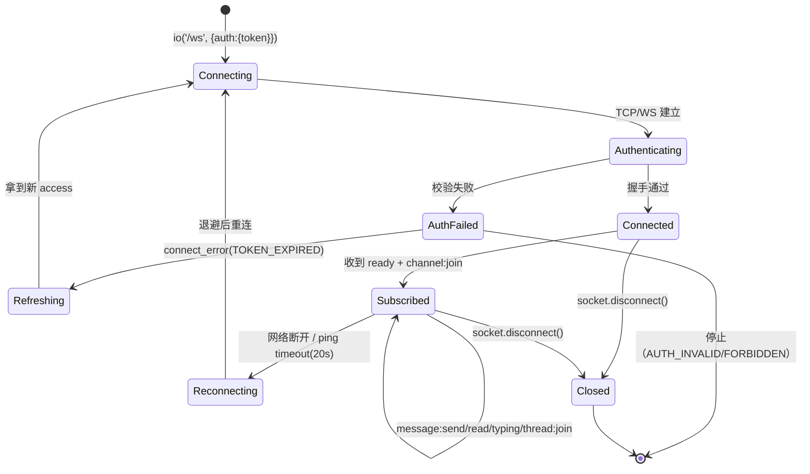

# 13 · WebSocket 事件协议

> 命名空间：`/ws`（RTC 预留命名空间 `/rtc`，见 §13.9）。
> 本文件与契约 `_contract.md` §6 **事件名、payload 字段、ack 语义完全一致**，仅补充 JSON 示例、超时/重试与连接状态机；契约 v1.2 §C 新增的 3 个会话事件（`conversation:created/updated/removed`）登记于 §13.3。
> 服务端实现：`server/src/ws/ws.gateway.ts`（事件注册）、`server/src/ws/ws.events.ts`（事件名与 payload schema）。

## 13.1 连接

> Socket.IO 的**传输路径**是 `/socket.io/`（可被反代），`/ws` 是**命名空间**；两者不要混用。
> `io('/ws', ...)` 走同源默认传输路径；`io('https://example.com/ws', ...)` 也会被解析为“主机 + 命名空间 /ws”。

```ts
import { io } from 'socket.io-client';

const socket = io('/ws', {
  path: '/socket.io/',          // 传输层路径（默认值，Caddy 反代这条路径）
  auth: { token: accessToken }, // access 15 分钟，过期后需先走 REST /auth/refresh
  transports: ['websocket'],    // 契约 §6 强制 websocket，不走 polling
});
```

握手流程：

1. **CORS**：WS 与 REST 共用同一份 `CORS_ORIGINS` 白名单（`ConfiguredIoAdapter` 在 `createIOServer` 注入，不使用 `origin:true`）。
2. 服务端中间件读取 `handshake.auth.token`，`TokenService.verifyAccess` 校验签名/过期/audience。
3. 校验通过后加载用户；`suspended` 同样拒绝。
4. 失败：`connect_error`，`error.message` 与 `error.data.code` 均为错误码（`AUTH_REQUIRED` / `TOKEN_EXPIRED` / `AUTH_INVALID` / `FORBIDDEN`）。
5. 成功：加入 `user:<userId>` 房间，刷新 presence，推送 `ready` 快照。

`connect_error` 示例：

```json
// socket.on('connect_error', (err) => err.message / err.data)
{ "message": "TOKEN_EXPIRED", "data": { "code": "TOKEN_EXPIRED" } }
```

## 13.2 客户端 → 服务端（全部带 ack 回调，5s 超时）

| 事件 | payload | ack |
| --- | --- | --- |
| `channel:join` | `{ channelId }` | `{ ok, channelId }` |
| `channel:leave` | `{ channelId }` | `{ ok }` |
| `message:send` | `{ channelId, clientMsgId, kind, body, parentId?, replyToId?, attachmentIds?, card? }` | `{ ok, message }` / `{ ok:false, code, message }` |
| `message:read` | `{ channelId, seq }` | `{ ok }` |
| `typing` | `{ channelId, state: "start"\|"stop" }` | `{ ok }` |
| `thread:join` | `{ rootId }` | `{ ok }` |
| `thread:leave` | `{ rootId }` | `{ ok }` |
| `presence:ping` | `{}` | `{ ok, serverTime }` |

### 13.2.1 payload 示例

```jsonc
// channel:join
{ "channelId": "0f8f8b3e-7a1c-4b1f-9d5a-1a2b3c4d5e6f" }

// message:send —— 纯文本
{
  "channelId": "0f8f8b3e-7a1c-4b1f-9d5a-1a2b3c4d5e6f",
  "clientMsgId": "11111111-1111-4111-8111-111111111111",
  "kind": "text",
  "body": "调度记录：第三轮全域信号已同步。"
}

// message:send —— 线程回复 + 附件 + 提及
{
  "channelId": "0f8f8b3e-7a1c-4b1f-9d5a-1a2b3c4d5e6f",
  "clientMsgId": "22222222-2222-4222-8222-222222222222",
  "kind": "image",
  "body": "@chen 请看这张测绘图",
  "parentId": "1024",
  "replyToId": "1020",
  "attachmentIds": ["5f2c1b9a-0c3d-4e5f-8a9b-0c1d2e3f4a5b"]
}

// message:send —— 随消息建卡（card 结构与 POST /cards 相同，无需 channelId）
{
  "channelId": "0f8f8b3e-7a1c-4b1f-9d5a-1a2b3c4d5e6f",
  "clientMsgId": "33333333-3333-4333-8333-333333333333",
  "kind": "card",
  "body": "下一阶段主题",
  "card": {
    "kind": "vote",
    "title": "下一阶段主题",
    "options": ["航测", "档案", "广播"],
    "data": { "multi": true, "anonymous": false, "closesAt": "2026-10-29T12:00:00.000Z" }
  }
}

// message:read
{ "channelId": "0f8f8b3e-7a1c-4b1f-9d5a-1a2b3c4d5e6f", "seq": "2048" }

// typing
{ "channelId": "0f8f8b3e-7a1c-4b1f-9d5a-1a2b3c4d5e6f", "state": "start" }

// thread:join / thread:leave
{ "rootId": "1024" }

// presence:ping
{}
```

字段约束：

- `clientMsgId` 必须是 uuid v4，是**唯一幂等键**（`(channel_id, sender_id, client_msg_id)`）。
- `parentId`、`replyToId`、`seq`、`rootId` 为 BIGINT 的十进制字符串（也接受 JS 安全整数）。客户端**不得**把它们当数字运算。
- `body` ≤ 8000 字符；`attachmentIds` ≤ 10；`card` 与 `kind:"card"` 必须同时出现。
- `channel:join` 需要读权限（公开频道对 owner/admin 开放，私密频道必须入群）；契约 v1.2 §C：DM/群聊同样用 `channel:join`，`channelId` 传会话 id，房间名仍为 `channel:<id>`，且只有 `channel_members` 成员能 join（owner/admin 不可越权）。

### 13.2.2 ack 示例

```jsonc
// 成功
{ "ok": true, "channelId": "0f8f8b3e-7a1c-4b1f-9d5a-1a2b3c4d5e6f" }

// 发消息成功（message 结构见 §13.3.2）
{ "ok": true, "message": { /* MessageView */ }, "dup": false }

// 重发命中幂等键（契约 §6：dup:true）
{ "ok": true, "message": { /* 已存消息 */ }, "dup": true, "code": "DUPLICATE_MESSAGE" }

// 失败
{ "ok": false, "code": "MUTED", "message": "禁言至 2026-10-23T00:00:00.000Z", "until": "2026-10-23T00:00:00.000Z" }
```

> 服务端**先持久化成功再 ack**。客户端 5s 未收到 ack → 用**同一 `clientMsgId`** 重发；服务端命中唯一键时返回 `dup:true` 与已存消息，不产生第二条。

## 13.3 服务端 → 客户端

| 事件 | payload |
| --- | --- |
| `ready` | `{ user, serverTime, channels: [{id,name,lastReadSeq,unread}] }` |
| `message:new` | `{ message }` |
| `message:updated` | `{ message }` |
| `message:deleted` | `{ messageId, channelId }` |
| `reaction:updated` | `{ messageId, cardId?, counts: {emoji:n}, mine: string[] }` |
| `receipt:update` | `{ channelId, userId, lastReadSeq }` |
| `presence:update` | `{ userId, status: "online"\|"offline", lastSeenAt }` |
| `card:created` / `card:updated` / `card:deleted` | `{ card }` / `{ cardId, channelId }` |
| `vote:updated` | `{ cardId, counts: {optionId:n}, total, voters }`（匿名投票 `voters=[]`） |
| `channel:created` / `channel:updated` | `{ channel }` |
| `conversation:created` | `{ conversation }`（契约 v1.2 §C） |
| `conversation:updated` | `{ conversation }`（契约 v1.2 §C；群公告变更也走此事件，`conversation.announcement` 为新值） |
| `conversation:removed` | `{ conversationId, reason: "left"\|"removed"\|"dissolved" }`（契约 v1.2 §C + Sprint1：`dissolved` = 群主解散归档） |
| `member:updated` | `{ channelId, userId, role, notifyLevel }` |
| `notification:new` | `{ notification }` |
| `error` | `{ code, message, requestId }` |
| `rtc:signal`（预留） | 恒返回 `NOT_IMPLEMENTED`，见 §13.9 |

### 13.3.1 投递范围（房间）

| 房间 | 加入方式 | 用于 |
| --- | --- | --- |
| `channel:<channelId>` | `channel:join` / REST 客户端自行订阅 | message/reaction/receipt/card/vote/member/channel 事件 |
| `thread:<rootId>` | `thread:join` | 线程内 `message:new`（回复同时进频道房与线程房） |
| `user:<userId>` | 连接时自动加入 | `notification:new`、新增频道的通知、**会话事件 `conversation:created/updated/removed`** |

> 契约 v1.2 §C：会话事件一律推 `user:<id>` 房间（不依赖客户端是否 `channel:join`），因此 DM/群聊的成员即使没有订阅 `channel:<id>` 也能收到「新建会话 / 改名 / 加人 / 被移除」。`channel:join` 对 DM/群聊同样适用，房间名仍是 `channel:<id>`（前端把会话 id 当 channelId 用）。

### 13.3.2 payload 示例

```jsonc
// ready
{
  "user": { "id": "…", "handle": "chen", "displayName": "陈工", "globalRole": "member", "avatarFileId": null },
  "serverTime": "2026-10-22T13:30:00.000Z",
  "channels": [
    { "id": "…", "name": "全域播报", "lastReadSeq": "2048", "unread": 3, "myRole": "member", "visibility": "public" }
  ]
}

// message:new
{
  "message": {
    "id": "2049",
    "channelId": "…",
    "senderId": "…",
    "kind": "text",
    "body": "调度记录：第三轮全域信号已同步。",
    "clientMsgId": "11111111-1111-4111-8111-111111111111",
    "parentId": null,
    "threadRootId": null,
    "replyToId": null,
    "cardId": null,
    "mentions": ["…"],
    "threadReplyCount": 0,
    "lastReplyAt": null,
    "editedAt": null,
    "deletedAt": null,
    "deletedBy": null,
    "createdAt": "2026-10-22T13:30:01.000Z",
    "attachments": [
      {
        "id": "…", "fileId": "…", "position": 0,
        "originalName": "survey.png", "mime": "image/png", "kind": "image",
        "sizeBytes": "204800", "width": 1280, "height": 720,
        "durationMs": null, "previewStatus": "pending"
      }
    ]
  }
}

// message:deleted（软删除，内容不再下发）
{ "messageId": "2049", "channelId": "…" }

// reaction:updated
{ "messageId": "2049", "cardId": null, "counts": { "✅": 3, "🛰️": 1 }, "mine": ["✅"] }

// receipt:update（服务端 300ms 合并后广播）
{ "channelId": "…", "userId": "…", "lastReadSeq": "2048" }

// presence:update
{ "userId": "…", "status": "online", "lastSeenAt": "2026-10-22T13:30:02.000Z" }

// vote:updated（匿名投票 voters 恒为 []）
{ "cardId": "…", "counts": { "opt-a": 4, "opt-b": 2 }, "total": 6, "voters": [] }

// member:updated（admin 修改成员角色/免打扰/禁言；移除时 role=null）
{ "channelId": "…", "userId": "…", "role": "moderator", "notifyLevel": "mentions" }

// notification:new
{
  "notification": {
    "id": "…", "type": "mention", "channelId": "…", "messageId": "2049", "cardId": null,
    "title": "陈工 在 #全域播报 提到了你", "body": "@chen 请看这张测绘图",
    "payload": { "channelId": "…", "messageId": "2049" },
    "readAt": null, "createdAt": "2026-10-22T13:30:03.000Z"
  }
}
```

// conversation:created（契约 v1.2 §C；DM 推双方、建群推每个成员、加人推新成员）
{
  "conversation": {
    "id": "…",                       // = channels.id，前端当 channelId 用
    "kind": "dm",                    // dm | group
    "name": "",                      // DM 为空串，由前端用 peer.displayName 渲染
    "slug": "dm-3f2a…",
    "members": [
      { "userId": "…", "handle": "chen", "displayName": "陈工", "avatarFileId": null, "role": "member", "lastReadSeq": "0", "joinedAt": "2026-10-22T13:30:00.000Z" }
    ],
    "peer": { "userId": "…", "handle": "lin", "displayName": "林测绘", "avatarFileId": null }, // 仅 DM 非空
    "announcement": null,            // 群公告（Sprint1；仅群聊非空，DM 恒 null）
    "lastMessageAt": null,
    "lastMessagePreview": null,
    "unreadCount": 0,
    "myRole": "member",
    "createdAt": "2026-10-22T13:30:00.000Z"
  }
}

// conversation:updated（改名 / 成员变化 / 群公告变更；每个成员收到的 unreadCount / myRole 各自计算）
{ "conversation": { /* 同上完整结构；公告变更时 conversation.announcement 为新值 */ } }

// conversation:removed（退出 / 被移除 / 群主解散）
{ "conversationId": "…", "reason": "left" }        // "left" = 本人退出；"removed" = 被 moderator 移除
{ "conversationId": "…", "reason": "dissolved" }   // Sprint1：群主解散归档（conversation 已 archived_at，不应再展示）
```

> 会话事件不携带消息内容；消息仍走 `message:new` / `message:new(channel:<会话id>)`。收到 `conversation:removed` 的客户端应从侧栏移除该会话，并停止对该 `channelId` 的订阅。

说明：

- `card:updated` 在 **reorder / assign / close** 时可能只带变更子集（如 `{ card: { channelId, kind, reordered: true } }`）；客户端应以 `card:created` 的完整结构或 REST 查询为准做合并。
- `channel:updated` 同理，归档时只带 `{ id, name, archived: true }`。
- `message:new` 中 `deletedAt` 永远为 `null`（软删除后只发 `message:deleted`）。

## 13.4 错误码（与契约 §8 一致）

| code | 触发场景（WS） |
| --- | --- |
| `AUTH_REQUIRED` | 握手未带 token |
| `TOKEN_EXPIRED` | token 过期，客户端应先 REST refresh 再重连 |
| `AUTH_INVALID` | 签名错误 / 用户不存在 / 会话撤销 |
| `FORBIDDEN` | 账号封禁 |
| `NOT_CHANNEL_MEMBER` | 非成员 join 或上报已读 |
| `CHANNEL_NOT_FOUND` | channelId 不存在 |
| `MUTED` | 禁言中发消息/建卡/投票（ack 带 `until`） |
| `VALIDATION_FAILED` | payload 校验失败（ack 带 `issues[]`） |
| `VOTE_CLOSED` | 已截止仍投票 |
| `FILE_NOT_READY` / `FILE_TYPE_NOT_ALLOWED` | 附件未就绪/类型不符 |
| `DUPLICATE_MESSAGE` | 幂等命中，`ok:true` + `dup:true` |
| `RATE_LIMITED` | 触发频率限制 |
| `NOT_IMPLEMENTED` | `rtc:signal` |
| `INTERNAL` | 未预期异常（日志含 requestId） |

## 13.5 超时与重试

| 场景 | 约定 |
| --- | --- |
| ack 超时 | 客户端 **5s**；超时后同一 `clientMsgId` 重发，最多 3 次指数退避（1s/2s/4s） |
| 幂等命中 | 服务端返回已存 `message` + `dup:true`，客户端按成功处理并替换本地临时消息 |
| 断线重连 | 指数退避（1s→30s 上限）+ 抖动；重连成功后重新 `channel:join`，用 REST `/channels/:id/messages?direction=newer&cursor=<lastReadSeq>` 补拉 |
| token 过期 | `connect_error: TOKEN_EXPIRED` → REST refresh → 用新 access 重连 |
| 重复连接 | 同一用户允许多端；presence 以“最后一条连接断开”为准发 `offline` |

## 13.6 连接状态机



服务端侧：

```text
handshake middleware
 ├─ 无 token            → connect_error AUTH_REQUIRED
 ├─ 过期                → connect_error TOKEN_EXPIRED
 ├─ 无效/用户不存在/封禁 → connect_error AUTH_INVALID / FORBIDDEN
 └─ 通过 → handleConnection（join user room → presence online → ready）
          → 事件循环（8 个客户端事件，逐个 ack）
          → handleDisconnect（最后一个连接 → presence offline）
```

## 13.7 已读回执链路（端到端）

```text
客户端滚动 → 本地 500ms 节流 → WS message:read { channelId, seq }
   → 服务端 ReadReceiptMerger（300ms 窗口，合并取 max）
   → UPDATE channel_members SET last_read_seq=$1 WHERE last_read_seq < $1
   → 广播 receipt:update 到 channel:<id>
   → 其他端据此更新“已读到这里”标记
```

## 13.8 与契约的差异（如实列出）

| 项 | 契约 | 实现 |
| --- | --- | --- |
| `typing` 广播 | 只定义了 C→S 事件与 ack | 实现只写 Redis（3s TTL）并 ack，**未新增** S→C 事件，避免超出 §6 事件表；如需“某人在输入”，需契约升版后补 S→C 事件 |
| `error` 事件 | 列在 S→C 表 | v1.0 保留但未使用：业务错误统一走对应请求的 ack（更精确），避免重复错误通道 |
| `rtc:signal` | “恒返回 NOT_IMPLEMENTED” | 作为 `/ws` 事件 ack `{ok:false, code:"NOT_IMPLEMENTED"}`；`/rtc` 命名空间建连即被拒（见 §13.9） |
| `ready.channels` | `{id,name,lastReadSeq,unread}` | 额外附带 `myRole`、`visibility`（纯增量字段，不破坏旧字段） |
| ack 附加字段 | `{ ok, message }` | 成功时追加 `dup`（§6 ack 语义本身要求 `dup:true`）；`MUTED` 追加 `until`（§8 要求） |

## 13.9 RTC 预留（契约 §11）

- Socket.IO 传输路径固定为 `/socket.io/`；`/ws`、`/rtc` 都是**命名空间**，不是 URL path。Caddy 只需反代 `/socket.io/*`。
- `/rtc` 命名空间与 `/ws` 共用同一 Socket.IO 服务端与 Redis adapter，但**不注册任何业务事件**。
- 握手中间件对 `/rtc` **恒拒绝**（与开关无关）：
  - 关闭：`connect_error`，`message = NOT_IMPLEMENTED`，`data = { code: "NOT_IMPLEMENTED", message, rtcSignalingEnabled: false }`；
  - 开启：同样 `NOT_IMPLEMENTED`，仅 `rtcSignalingEnabled: true`——表达“已预留、未实现”，而不是“参数错误”。
  - 这样客户端拿到的是明确的 `connect_error`，而不是 Socket.IO 的 `Invalid namespace`。
- `RTC_SIGNALING_ENABLED=false` 为 v1.0 唯一合法值；生产环境设为 `true` 会在启动阶段被 `config/env.ts` 拒绝。
- `POST /api/v1/rtc/token` 恒返回 `501 NOT_IMPLEMENTED`。
- 未来接入 LiveKit/SFU 时只替换 `/rtc` 的中间件与事件实现，不改 `/ws` 与消息链路。

客户端处理示例：

```ts
const rtc = io('/rtc', { auth: { token }, transports: ['websocket'] });
rtc.on('connect_error', (error) => {
  // error.message === 'NOT_IMPLEMENTED'
  const code = (error as unknown as { data?: { code?: string } }).data?.code;
  // 按契约 §11 处理：提示“音视频能力尚未开放”，不要重试
});
```
