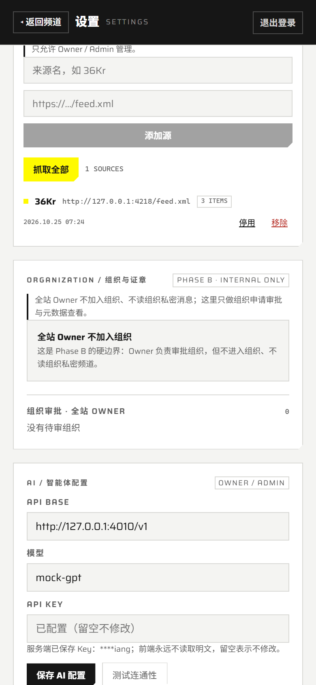
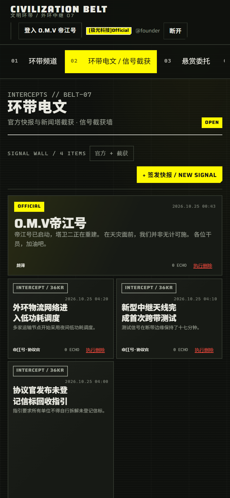

# Sprint5 / Phase E · RSS 新闻塔与前端 UI

日期：2026-10-25  
范围：RSS 抓取、新闻塔源管理、电文自动入墙、管理 UI。  
说明：权限拦截 / 组织系统 / 好友申请已在 B/D 阶段落盘；本次回归确认未回退。

## Schema 与迁移

新增：

- `rss_sources`
  - `name / url / enabled`
  - `created_by`
  - `last_fetched_at / last_item_count / last_error`
- `rss_items`
  - `source_id`
  - `external_id`（同源唯一，抓取幂等）
  - `title / link / published_at`
  - `post_id` unique
- 迁移：[0014_rss_news_tower](../prisma/migrations/0014_rss_news_tower/migration.sql)

迁移说明：

- 先执行了 `npx prisma migrate dev --name rss_news_tower`。
- 因仓库已有 `inet` / `search_vector` 等 Prisma `Unsupported` 列，`migrate dev` 被既有 drift 警告 + 非交互环境阻塞；没有执行 reset。
- 改为显式 0014 迁移 + `prisma migrate deploy`，只建 RSS 两张表，未改/未删既有列。
- 当前 **14 个迁移全部应用**，`prisma migrate status` 为 up to date。

## 后端

新增 `RssModule`：

| 方法 | 路径 | 权限 |
|---|---|---|
| GET | `/api/v1/rss/sources` | 登录内部用户 |
| POST | `/api/v1/rss/sources` | owner/admin |
| PATCH | `/api/v1/rss/sources/:id` | owner/admin |
| DELETE | `/api/v1/rss/sources/:id` | owner/admin |
| POST | `/api/v1/rss/fetch` | owner/admin |

抓取逻辑：

- `rss-parser@3.13.0`，12s 超时，最多 50 条/源。
- `rss_items (source_id, external_id)` 幂等；重复抓取不会重复发帖。
- 只写入 `Post(surface='belt', board='telegraph', source='rss')`。
- 保留 `sourceUrl`、`sourceName`、原始 `publishedAt`。
- HTML 清洗后写正文，最长 8000。
- 系统作者优先取现有 Bot，回退源创建者/Owner。
- 抓取失败写回 `rss_sources.last_error`，不抛出整批失败。
- 删除 RSS 源级联删除 `rss_items`，但保留已抓取电文。

## 前端

设置页新增【新闻塔】Tab：

- Owner/Admin 可添加来源、抓取全部、停用/启用、移除。
- 展示 `itemCount`、`lastFetchedAt`、`lastError`。
- 非 Owner/Admin 只读。
- 抓取报告展示 fetched / created / skipped。

环带电文页：

- 已有 `BeltTelegraphView` 自动读取 `telegraph` 版块的 RSS Post。
- RSS 卡片显示 `INTERCEPT / 来源名` 与原始时间。
- 官方快报继续作为跨两列大卡。

## 验证

### 构建

```text
server pnpm build      -> exit 0
server pnpm typecheck  -> exit 0
server pnpm test       -> 18 files / 176 tests passed
web pnpm build         -> ✓ Compiled successfully
```

新增定向单测 [rss.spec.ts](../server/test/rss.spec.ts)：

- RSS URL 只接受 http/https
- SourceView 创建/规范化
- 停用/删除源

### RSS E2E

本地真实 RSS feed + 真实 API + PostgreSQL：

```text
RSS_E2E_RESULT={"ok":true,"checks":19}
```

覆盖：

- 非法 URL 400
- 创建源 201
- 抓取 2 条
- 首次写入 2 条 Post
- HTML 清洗
- 来源链接保留
- `rss_items` 2 条
- 二次抓取 created=0 / skipped=2
- lastFetchedAt / itemCount
- 删除源级联 rss_items
- 删除源保留已抓取电文

### UI

```text
SPRINT5_UI_RESULT={"ok":true,...}
RSS_SETTINGS_VISIBLE true
RSS_TELEGRAPH_VISIBLE true
RSS_SOURCE_LABEL true
```





测试源和抓取帖子已清理，当前 `rss_sources` / `rss_items` 均为 0。

## 启动

当前服务已启动：

- Web `3100`
- API `3000`
- PostgreSQL `55432`
- Redis `6379`
- S3 `9000`

健康检查：`/readyz` 200，Web 200。
