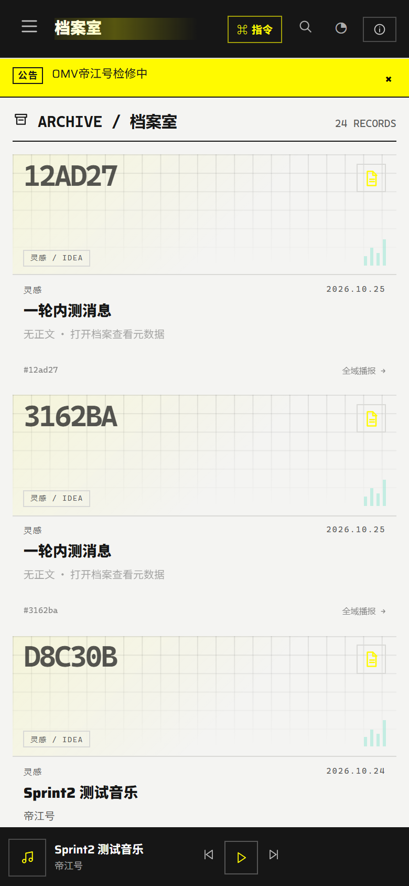
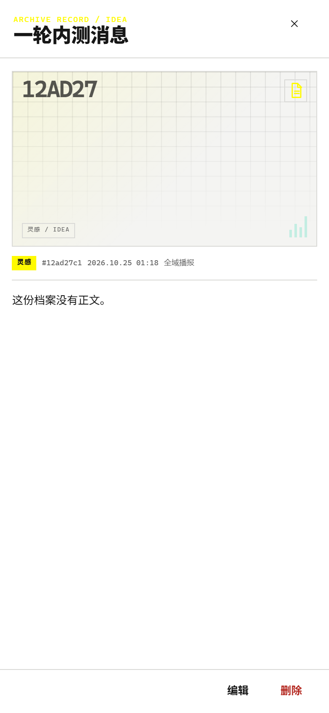
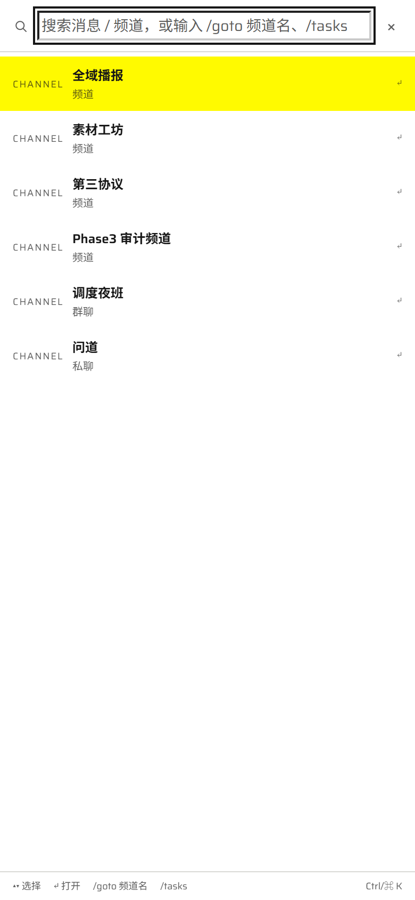
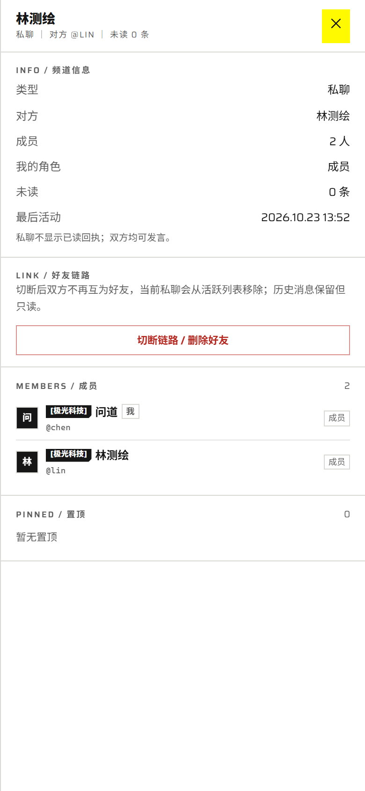
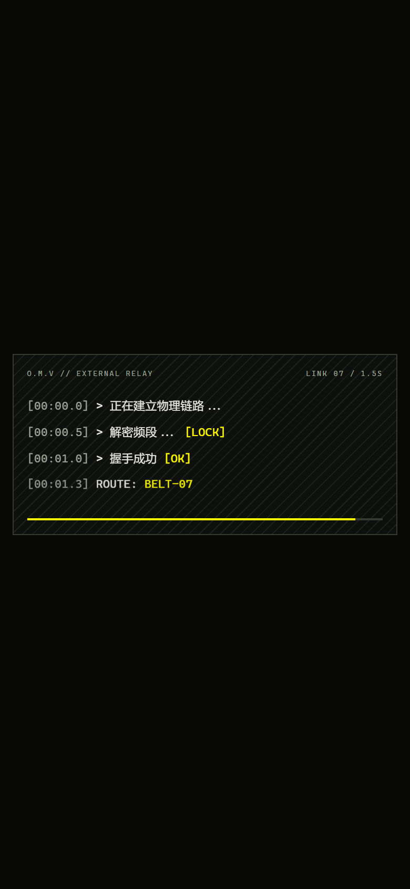
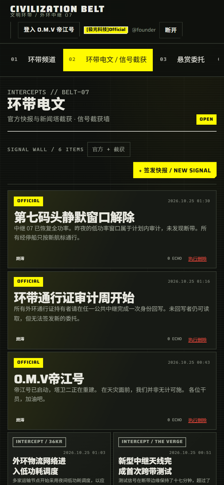

# 390px 移动端 6 项体验修复

日期：2026-10-25  
范围：仅前端交互与布局；未改表结构、未改后端 DTO/权限。

## 1. 档案室

- 无图档案不再显示 `NO PREVIEW`，改为纯 CSS 封面：
  - 极简网格
  - 大号档案编号
  - 类型 Icon（素材/灵感/作品）
  - 类型标签与信号柱
- 点击卡片不再跳回聊天，改为打开右侧档案详情 Drawer。
- Drawer 展示完整正文、图片、类型、编号、时间、频道。
- 提供【编辑】与【删除】：
  - `PATCH /cards/:id`
  - `DELETE /cards/:id`（软删除）
- 删除后立即从档案列表移除；编辑后列表同步更新。
- Drawer 使用 portal + `signal-drawer`，390px 下为全屏宽。

截图：





## 2. 移动端指令入口

- `ChatHeader` 在 `md:hidden` 下新增 `⌘ 指令` 按钮，点击派发 `dj:open-command`。
- `WorkspaceView` 监听事件打开 Command Palette。
- Command Palette 移动端改为真正全屏：
  - `h-dvh`，无外边距
  - 列表 `flex-1` 可滚动
  - 增加移动端关闭按钮
  - 桌面端保持原居中面板

截图：



## 3. 好友删除

- 私聊详情 Drawer 新增 `LINK / 好友链路` 区块。
- 显示风险说明与【切断链路 / 删除好友】按钮。
- 二次确认后：
  - 前端从 `/friendships` 找到该 DM 对应的 accepted 关系；
  - 调用 `DELETE /friendships/:id`；
  - 从会话列表移除；
  - 关闭详情并回到首个可用频道。
- 历史消息保留，服务端将其变为只读。

截图：



## 4. 登录过场动画

- `.belt-entry` 改为 `min-height/max-height: 100dvh`。
- 增加 `overflow-y: auto`、安全区 padding、内部滚动。
- `.belt-entry-frame` 限制 `max-height: calc(100dvh - 1.5rem)` 并允许内部滚动。
- 过场遮罩使用 `createPortal` 挂到 `body`，修复侧边栏 transform 导致 fixed 只覆盖侧栏宽度的问题。
- 390px 实测 4 行终端代码全部可见，frame 宽 366，完整落在 390×844 视口内。

截图：



## 5. 论坛内容删除

- 电文 Bento 卡片、快报/悬赏/日常卡片、帖子详情均增加【执行删除】。
- 仅发帖人本人或 Owner/Admin 显示。
- 二次确认后调用 `DELETE /belt/posts/:id`（软删除）。
- 卡片点击删除后立即从当前列表移除；详情页删除后返回对应版块。
- 实测 Bento 卡片数量 `6 -> 5`。

## 6. 电文与快报合并

- 导航 02 改为【环带电文 / 信号截获】，移除独立 05 导航。
- `/belt/dispatch` 使用 `BeltTelegraphView`：
  - 同时拉取 `bulletin` 与 `telegraph`。
  - 官方快报作为大卡，跨两列。
  - RSS/截获新闻使用小卡，按 3 条一组错落，其中一条纵向拉高。
  - 每条显示 `OFFICIAL` 或 `INTERCEPT / 来源` 与原始时间。
- `/belt/telegraph` 仍兼容渲染合并版。
- Owner/Admin 可继续使用发布抽屉签发快报。

截图：



## 验证

390×844 视口，`deviceScaleFactor: 2`：

```text
ARCHIVE_CSS_COVERS 23
ARCHIVE_NO_PREVIEW 0
ARCHIVE_DRAWER 1 EDIT 1 DELETE 1
COMMAND_BUTTON 1
COMMAND_PANEL 1
ENTRY_FRAME width 366 / viewport 390x844 · WITHIN true
BENTO 6 FEATURE 3 OFFICIAL_LABEL 3 INTERCEPT_LABEL 3
POST_DELETE 6 -> 5
FRIEND_CUT_BUTTON 1
FRIEND_STATUS_AFTER removed
MOBILE_UX_RESULT={"ok":true,...}
```

测试产生的帖子已删除；chen↔lin 好友关系已恢复为 accepted。

构建：

```text
web pnpm build -> ✓ Compiled successfully
```
